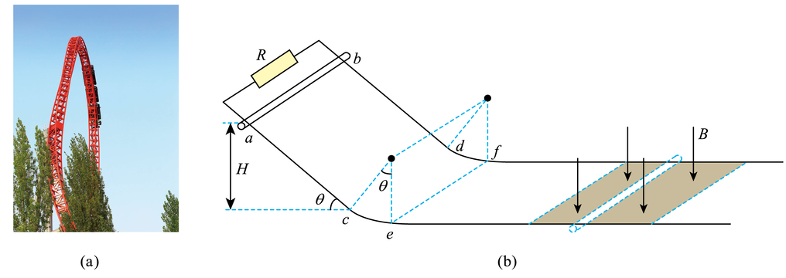
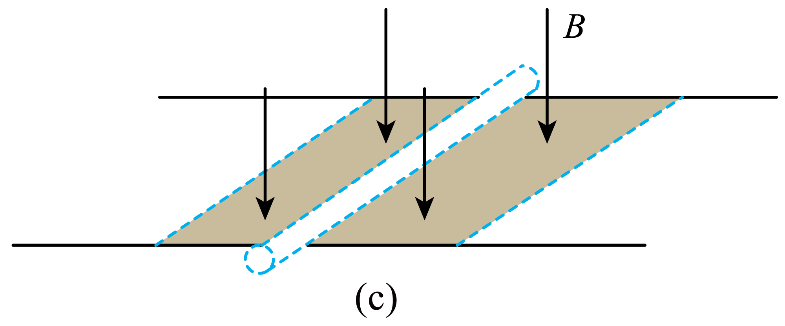
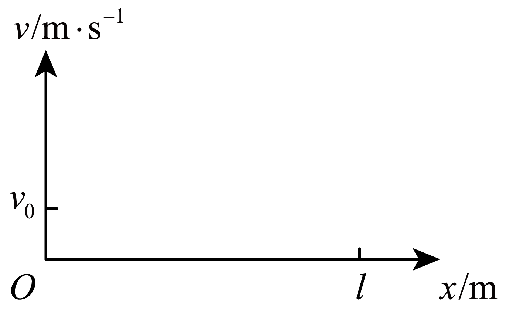

# Physics - 题目 2831

**ID**: 6c8ba9591a0a403ba24a7d2d19b1c19d
**年级**: Grade 12
**难度**: Medium-Hard
**题型**: Comprehensive

## 题目
疯狂过山车阅读下列材料，完成下面小题。​​​​​​​‌图（a）是游乐园常见的“疯狂过山车”项目，该系统结构可以简化成图（b）的“单棒”模型。导体棒在ab处由静止释放，先经直轨道到达cd处，然后沿切线进入光滑圆弧轨道，圆弧轨道的底端ef又与足够长的光滑水平导轨相切。图中两导轨之间的阴影区域是一个正方形，其内有竖直向下的匀强磁场。（重力加速度g取10 m/s^{2}）(1)若导体棒在直轨道ac(bd)上的动摩擦因数μ＝0.5，圆弧轨道ce(df)的半径r＝2 m，角度θ＝37°，释放高度H＝3 m，导体棒质量m＝1 kg。则：①导体棒在直轨道ac(bd)上运动的加速度大小a＝m/s^{2}，1s末重力的瞬时功率P_{1}＝W。(2)导体棒到达圆弧轨道的底端ef处对轨道的压力大小。(3)已知定值电阻为R，导体棒电阻为R_{0}，水平导轨间距为l，磁场的磁感应强度大小为B。导体棒以速度v_{0}进入正方形阴影区域磁场后，受到一个水平向右的外力F作用。①在图（c）中标出通过导体棒的感应电流方向。②若导体棒在磁场中做匀速直线运动，则外力F的表达式为。③若导体棒质量为m，进入磁场后做加速度为a的匀加速直线运动。i.（简答）求外力F与瞬时速度v的函数关系式。（结果用字母表示）ii.导体棒与磁场左边界的距离为x，若导体棒在出磁场前就撤去外力，定性画出导体棒在磁场中运动可能出现的“v-x”图线。（作图题，不需要写出演算过程）

## 解答

1. （1）[1]根据牛顿第二定律得导体棒在直轨道ac(bd)上运动的加速度大小
2. $a=g\sin θ-μg{\cos}θ=2{{\rm{m}}}/{{\rm{s}}}{^{2}}$
3. [2]1s末的速度为
4. $v=at=2{{\rm{m}}}/{{\rm{s}}}$
5. 1s末重力的瞬时功率
6. $P{{}_{1}}=mgv\sin θ=12{\rm{W}}$
7. （2）导体棒从释放到圆弧轨道的底端ef处，由动能定理得
8. $mg\left ({H+r-r\sin θ}\right )-{\rm μm}g{\cos}θ\times \frac {H}{\sin θ}=\frac {1}{2}mv{{}_{1}^{2}}$
9. 导体棒到达圆弧轨道的底端ef处，由牛顿第二定律得
10. $F{{}_{{\rm{N}}}}-mg=\frac {mv{{}_{1}^{2}}}{r}$
11. 解得
12. $F{{}_{{\rm{N}}}}=24{\rm{N}}$
13. 由牛顿第三定律得导体棒到达圆弧轨道的底端ef处对轨道的压力大小为24N。
14. （3）[1]由右手定则知导体棒中的电流方向如图所示
15. 
16. [2]导体棒切割磁感线产生的感应电动势和电流分别为
17. $E=BLv{{}_{0}}$ ， $I=\frac {E}{R+R{{}_{0}}}$
18. 导体棒受到的安培力
19. $F{{}_{安}}=BIL=\frac {B{^{2}}L{^{2}}v{{}_{0}}}{R+R{{}_{0}}}$
20. 若导体棒在磁场中做匀速直线运动，外力等于安培力
21. $F=F{{}_{安}}=\frac {B{^{2}}L{^{2}}v{{}_{0}}}{R+R{{}_{0}}}$
22. [3]当导体棒的速度为v时，由牛顿第二定律得
23. $F^{′}-F{{}_{安}}{^{\prime }}=F-\frac {B{^{2}}L{^{2}}v}{R+R{{}_{0}}}=ma$
24. 解得
25. $F^{′}=\frac {B{^{2}}L{^{2}}v}{R+R{{}_{0}}}+ma$
26. [4]撤去外力前，导体棒在磁场中做匀加速运动，有
27. $v{^{2}}-v{{}_{0}^{2}}=2ax$
28. 整理得
29. $v=\sqrt {v{{}_{0}^{2}}+2ax}$
30. 由数学知识知图像为
31. 
32. 设撤力瞬间导体棒的速度为v_{1}，撤去力F后，由动量定理得
33. $-\sum \frac {B{{}^{2}}L{^{2}}v}{R+R{{}_{0}}}\cdot Δt=mv^{′}-mv{{}_{1}}$
34. 整理得
35. $v^{′}=v{{}_{1}}-\frac {B{{}^{2}}L{^{2}}x}{R+R{{}_{0}}}$
36. 图像为斜向下的直线，由于磁场宽度未知，无法判断何时减速至0，可能的图像为
37. 

## 知识点

**中文**:
  - 电磁感应定律中的图像问题

**English**:
  - Graph Problems in EM Induction

---
