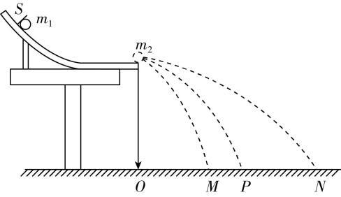

# Physics - 题目 2093

**ID**: 2177a806c9f9442e8190c3e553befb12
**年级**: Grade 12
**难度**: Medium-Hard
**题型**: Experiment

## 题目
（10分）如图甲所示，让两个小球在斜槽末端碰撞来验证动量守恒定律。​​​​​​​‌甲（1） 关于本实验，下列做法正确的是（填选项前的字母）。

## 解答

1. （1） 实验中要保证碰撞后小球做平抛运动，则实验前需要调节装置使斜槽末端水平， $\mathrm{A}$ 正确；为使两小球发生对心碰撞，两小球的半径需要相同， $\mathrm{B}$ 错误；为使碰后两球均向前飞出，需要用质量大的小球去碰撞质量小的小球， $\mathrm{C}$ 正确。
2. （2）  $\mathrm{a}$ .用圆规画圆，尽可能用最小的圆把各个落点圈住，这个圆的圆心位置代表平均落点。
3. $\mathrm{b}$ .碰撞后小球均做平抛运动，由 $x=vt$ , $ℎ=\frac{1}{2}g{t}^{2}$ 知， $v=x\sqrt{\frac{g}{2ℎ}}$ ，则平抛初速度与水平射程成正比，则需验证的等式为 ${m}_{1}OP={m}_{1}OM+{m}_{2}ON$ 。
4. （3） 设轻绳长为 $L$ ，小球从偏角为 $\theta $  处由静止摆下，在最低点时速度为 $v$ ，小球经过圆弧对应的弦长为 $l$ ，由动能定理得 $mgL(1-\cos \theta )=\frac{1}{2}m{v}^{2}$ ，又由几何关系得 $\sin \frac{\theta }{2}=\frac{l}{2L}$ ， $\cos \theta =1-2{\sin }^{2}\frac{\theta }{2}$ ，解得 $v=l\sqrt{\frac{g}{L}}$ ，可知碰撞前后的速度与弧长对应的弦长成正比，若两球碰撞过程中动量守恒，则需满足 $m{l}_{1}=-m{l}_{2}+M{l}_{3}$ 。

## 知识点

**中文**:
  - 研究斜槽末端小球碰撞时的动量守恒

**English**:
  - Momentum Conservation in Collision at End of Inclined Ramp

---
