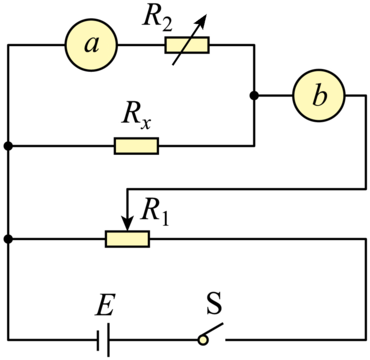
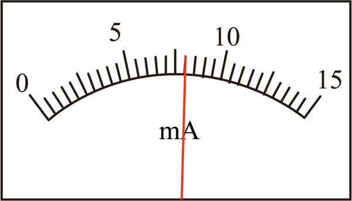

# Physics - 题目 1130

**ID**: 248e9a2aca6a4dd8b9e4470c5535ff24
**年级**: Grade 12
**难度**: Medium-Hard
**题型**: Experiment

## 题目
为尽可能精确测定待测电阻Rx的阻值（约为200Ω），准备器材如下：电池组E（电动势3V，内阻不计）；电流表A_{1}（量程0~15mA，内阻约为100Ω）；电流表A_{2}（量程0~300μA，内阻为1000Ω）；滑动变阻器R_{1}（阻值范围0~20Ω，额定电流2A）；电阻箱R_{2}（阻值范围0~9999.9Ω，额定电流1A）；开关、导线若干。​​​​​​​‌（1）如图所示的电路中，将电阻箱R_{2}的阻值调到9000Ω，在a、b两处分别接入电流表，其中在a处接入的电流表为（填写器材代号）。（2）调节滑动变阻器R_{1}，其中一只电流表的示数如图所示，其示数为mA；此时另一只电流表的示数为150μA，则待测电阻Rx的阻值为Ω；（保留三位有效数字）（3）利用提供的实验器材，以下电路设计方案中也能够比较精确测定Rx阻值的是（      ）

## 解答

1. （1）因为电流表A_{2}内阻已知，所以a处接入的电流表为A_{2}，与电阻箱R_{2}串联后可知待测电阻的两端电压。
2. （2）其中一只电流表的示数如图所示，由题图可知其示数为8.0mA；
3. 此时另一只电流表的示数为150μA，则待测电阻Rx两端电压为 $U{{}_{x}}=150\times 10{^{-6}}\times (9000+1000){\rm{V}}=1.5{\rm{V}}$ ，通过待测电阻Rx的电流为 $I{{}_{x}}=8.0\times 10{^{-3}}{\rm{A}}-150\times 10{^{-6}}{\rm{A}}=7.85\times 10{^{-3}}{\rm{A}}$ ，则待测电阻R_{x}的阻值为 $R{{}_{x}}=\frac {U{{}_{x}}}{I{{}_{x}}}=\frac {1.5}{7.85\times 10{^{-3}}}Ω\approx 191Ω$
4. （3）由电路图可知，分别先后闭合开关S_{2}、S_{3}，调节电阻箱R_{2}使得两次电流表示数相同，即通过等效替代法可以比较精确测定Rx阻值，A正确；由电路图可知，无法测得通过Rx的电流，B错误；由电路图可知，由于A_{1}表内阻未知，且存在分压作用，所以无法比较精确测定Rx的两端电压，则不可以比较精确测定Rx阻值，C错误。

## 知识点

**中文**:
  - 实验：电阻的测量

**English**:
  - Experiment: Measuring Resistance

---
