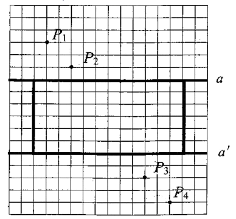

# Physics - 题目 1923

**ID**: 2b61c2c6242e4e90afd9520781787934
**年级**: Grade 12
**难度**: Medium-Hard
**题型**: Experiment

## 题目
某同学利用“插针法”测量一长方体玻璃砖的折射率，部分实验步骤如下：①将一张方格纸固定在木板上，玻璃砖放在方格纸上，如图所示，在纸上画出玻璃砖的两条边a和a′；②在玻璃砖的一侧插上两个大头针P_{1}、P_{2}，然后眼睛在另一侧透过玻璃砖看两个大头针，插上第三个大头针P_{3}，使P_{3}挡住P_{1}、P_{2}的像，再插上第四个大头针P_{4}，使P_{4}挡住P_{3}和P_{1}、P_{2}的像．请根据该同学的做法按下列要求作答：I.​​​​​​​‌在图中作出完整光路图和所需的辅助线，并求出该玻璃砖的折射率；II.已知玻璃砖的厚度为d，光在真空中的传播速度为c，求本次实验中光通过玻璃砖所用的时间（不考虑反射）．

## 解答

1. I.光路如图所示，设P_{1}P_{2}与a的交点为O_{1}，P_{3}P_{4}与a'的交点为O_{2}，过O_{1}作a的垂线，交a'于B点，过P_{1}做a的平行线，与过O_{1}的垂线相交于A点；
2. 
3. 在△P_{1}O_{1}A中，设∠P_{1}O_{1}A= $θ$_{1}，则sin $θ$_{1}= $\frac {AP{{}_{1}}}{P{{}_{1}}Q{{}_{1}}}=\frac {\sqrt {2}}{2}$
4. 在△O_{1}O_{2}B中，设∠O_{1}O_{2}B= $θ$_{2}，则sin $θ$_{2}= $\frac {BO{{}_{1}}}{O{{}_{1}}O{{}_{2}}}=\frac {\sqrt {5}}{5}$
5. 由折射定律，n= $\frac {{\rm{s}}{\rm{i}}{\rm{n}}θ{{}_{1}}}{{\rm{s}}{\rm{i}}{\rm{n}}θ{{}_{2}}}=\frac {\sqrt {10}}{2}$
6. II.光在玻璃砖中的速度 $v=\frac {c}{n}=\frac {\sqrt {10}}{5}c$
7. 光在玻璃砖中通过的路程s=O_{1}O_{2}
8. O_{1}O_{2}= $\frac {d}{{\cos}θ{{}_{2}}}=\frac {\sqrt {5}}{2}d$
9. 光通过玻璃砖所用时间 $t=\frac {s}{v}=\frac {5\sqrt {2}d}{4c}$

## 知识点

**中文**:
  - 实验：测量玻璃或其他物质的折射率

**English**:
  - Experiment: Measuring Refractive Index

---
