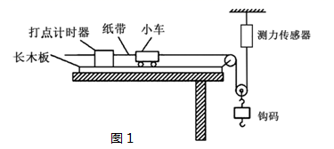

# Physics - 题目 445

**ID**: 3308bc87aad3482a8ef83994e1870508
**年级**: Grade 12
**难度**: Medium-Hard
**题型**: Experiment

## 题目
某同学为探究小车动能变化与合外力做功的关系，设计了如图1所示的实验装置。​​​​​​​‌一端带有定滑轮的长木板固定在桌面上，用细绳绕过定滑轮及轻质动滑轮将小车与测力传感器连起来。实验时，改变悬挂的钩码个数进行多次测量，记录测力传感器的示数F，并利用纸带计算出小车对应的速度。(1)实验中为使细绳对小车的拉力为小车受到的合外力，下列的做法正确的是。

## 解答

1. (1)[1]A．小车所受的拉力可由测力传感器直接测出，钩码的质量不需要远小于小车的质量，故A错误；
2. B．实验过程中，要使小车和长木板右端定滑轮间的细绳与长木板始终保持平行，平衡摩擦力，故B正确；
3. C．小车不连细绳时，纸带上打下的点分布均匀，说明摩擦力与重力沿木板向下的分力平衡，细绳的拉力是小车的合外力，故C正确。
4. 故选BC。
5. (2)[2][3]对bc段进行研究，则细绳拉力对小车做的功
6. $W=Fs{{}_{2}}$
7. 利用匀变速直线运动的推论得
8. $v{{}_{{\rm{b}}}}=\frac {s{{}_{1}}+s{{}_{2}}}{2T}$
9. $v{{}_{{\rm{c}}}}=\frac {s{{}_{2}}+s{{}_{3}}}{2T}$
10. 小车动能的增加量
11. $\Delta E{{}_{{\rm{k}}}}=\frac {1}{2}M\left [{\left({\frac {s{{}_{2}}+s{{}_{3}}}{2T}}\right)^{2}}-{\left({\frac {s{{}_{1}}+s{{}_{2}}}{2T}}\right)^{2}}\right ]$
12. (3)[4][5]摩擦力已经平衡，细绳拉力对小车做的功是小车合外力做的功W，则有
13. $W=\frac {1}{2}Mv{{}_{{\rm{B}}}^{2}}-\frac {1}{2}Mv{{}_{{\rm{A}}}^{2}}$
14. 解得
15. ${\left({\Delta v}\right)^{2}}=\frac {2}{M}W$
16. 即 ${\left({\Delta v}\right)^{2}}$ 应与W成正比，故BCD错误，A正确。
17. 故选A。
18. 图像的斜率为k，则小车的质量
19. $M=\frac {2}{k}$

## 知识点

**中文**:
  - 实验：探究做功与物体动能变化的关系

**English**:
  - Experiment: Work vs Change in Kinetic Energy

---
