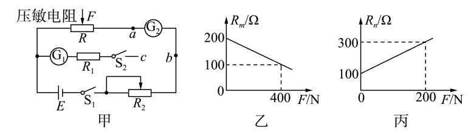
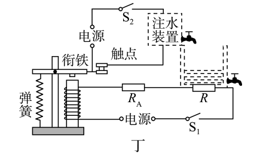

# Physics - 题目 2651

**ID**: 5443f8b87a4642fd971d64e98f11c36c
**年级**: Grade 12
**难度**: Medium-Hard
**题型**: Experiment

## 题目
材料的电阻随压力的变化而变化的现象称为“压阻效应”，利用这种效应可以制作压敏电阻。​​​​​​​‌某中学创新小组准备从实验室中两个压敏电阻m、n中选择一个，与电磁继电器组成电路为学校食堂设计一个小型“可自动注水的储水池”，主要步骤如下：(1)利用图甲所示电路测量压敏电阻的阻值随压力变化的规律。主要器材如下：压敏电阻两个电源（电动势E=12V，内阻不计）电流表G_{1}（量程10mA，内阻Rg_{1}=200Ω）电流表G_{2}（量程50mA，内阻Rg_{2}约为100Ω）定值电阻R_{1}=200Ω滑动变阻器R_{2}（最大阻值为150Ω）开关S_{1}、S_{2}及导线若干①为尽量准确的测量压敏电阻的阻值，导线c端应与（选填“a”或“b”）点连接。②首先测量R_{0}的数值，正确连接电路，使压敏电阻上的压力F=0，闭合开关S_{1}、S_{2}，调节滑动变阻器的滑片到合适位置，分别记录电流表G_{2}和G_{1}的读数I_{2}和I_{1}，可知R_{0}=（用字母I_{1}、I_{2}、Rg_{1}、R_{1}表示）。③两名同学分别测得两个压敏电阻m、n的阻值随压力变化的图像如图乙、丙所示。(2)“可自动注水储水池”的电路如图丁所示，R_{A}为保护电阻。当线圈中的电流超过某一值I_{0}时，继电器的衔铁将被吸合，与上方触点分离、注水装置所在电路断开并停止注水。①分析原理可知，压敏电阻应选择（选填“m”或“n”），水位上升时，保护电阻R_{A}的电功率会（选填“变大”或“变小”）。②若想增大可自动注水储水池的蓄水量，可将保护电阻R_{A}的阻值（选填“变大”或“变小”）。

## 解答

1. （1）①[1]选“a”时，测量无系统误差，导线c端应与“a”点连接。
2. ②[2]并联支路电压相等，有 $(I{{}_{2}}-I{{}_{1}})R{{}_{0}}＝I{{}_{1}}(R{{}_{1}}+R{{}_{g1}})$ ，解得 $R{{}_{0}}=\frac {I{{}_{1}}(R{{}_{1}}+R{{}_{g1}})}{I{{}_{2}}-I{{}_{1}}}$
3. （2）①[1][2]水位上升时，继电器的衔铁将被吸合，说明电磁铁磁性变强，电路中电流变大，压敏电阻R的阻值会变小，选m；水位上升时，电路中电流变大，保护电阻R_{A}的电功率变大。
4. ②[3]若想增大可自动注水储水池的蓄水量，即压力更大，压敏电阻阻值更小时停止注水，由于停止注水时的电流I_{0}不变，应将保护电阻R_{A}阻值变大。

## 知识点

**中文**:
  - 生活中的传感器

**English**:
  - Sensors in Daily Life

---
