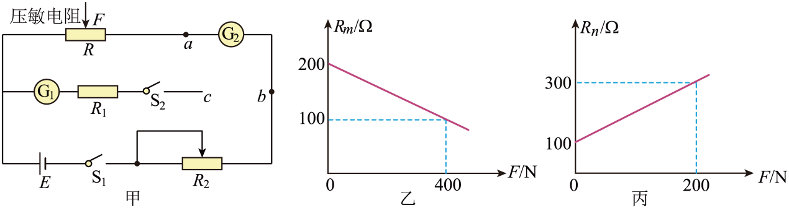
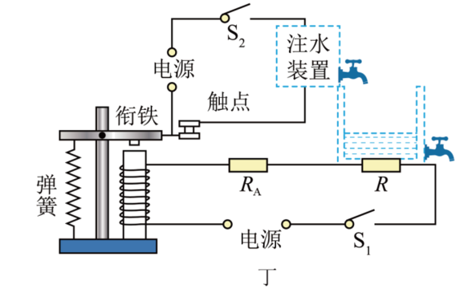

# Physics - 题目 2110

**ID**: 5f29cd3555e748ed92190161ddff62ea
**年级**: Grade 12
**难度**: Medium-Hard
**题型**: Experiment

## 题目
材料的电阻随压力的变化而变化的现象称为“压阻效应”，利用这种效应可以制作压敏电阻。​​​​​​​‌某中学创新小组准备从实验室中两个压敏电阻m、n中选择一个，与电磁继电器组成电路为学校食堂设计一个小型“可自动注水的储水池”，主要步骤如下：(1)利用图甲所示电路测量压敏电阻的阻值随压力变化的规律。主要器材如下：压敏电阻两个电源（电动势 $E=12{\rm{V}}$ ，内阻不计）电流表 ${\rm{G}}{{}_{1}}$ （量程 $10{\rm{m}}{\rm{A}}$ ，内阻 $R{{}_{{\rm{g}}1}}=200Ω$ ）电流表 ${\rm{G}}{{}_{2}}$ （量程 $50{\rm{m}}{\rm{A}}$ ，内阻 $R{{}_{{\rm{g}}2}}$ 约为 $100Ω$ ）定值电阻 $R{{}_{1}}=200\Omega $滑动变阻器 $R{{}_{2}}$ （最大阻值为 $150Ω$ ）开关 ${\rm{S}}{{}_{1}}$ 、 ${\rm{S}}{{}_{2}}$ 及导线若干①为尽量准确的测量压敏电阻的阻值，导线c端应与（选填“a”或“b”）点连接。②首先测量压敏电阻零压力时的阻值 $R{{}_{0}}$ ，正确连接电路，使压敏电阻上的压力 $F=0$ ，闭合开关 ${\rm{S}}{{}_{1}}$ 、 ${\rm{S}}{{}_{2}}$ ，调节滑动变阻器的滑片到合适位置，分别记录电流表 ${\rm{G}}{{}_{2}}$ 和 ${\rm{G}}{{}_{1}}$ 的读数 $I{{}_{2}}$ 和 $I{{}_{1}}$ ，可知 $R{{}_{0}}=$ （用字母 $I{{}_{1}}$ 、 $I{{}_{2}}$ 、 $R{{}_{{\rm{g}}1}}$ 、 $R{{}_{1}}$ 表示）。③两名同学分别测得两个压敏电阻m，n的阻值随压力变化的图像如图乙、丙所示。(2)“可自动注水储水池”的电路如图丁所示， $R{{}_{{\rm{A}}}}$ 为保护电阻。当线圈中的电流超过某一值 $I{{}_{0}}$ 时，继电器的衔铁将被吸合，与上方触点分离、注水装置所在电路断开并停止注水。①分析原理可知，压敏电阻应选择（选填“m”或“n”），水位上升时，保护电阻 $R{{}_{{\rm{A}}}}$ 的电功率会（选填“变大”或“变小”）。②若想增大可自动注水储水池的蓄水量，可将保护电阻 $R{{}_{{\rm{A}}}}$ 的阻值（选填“变大”或“变小”）。

## 解答

1. （1）①[1]根据题意，结合图甲电路图可知，由于电流表 ${\rm{G}}{{}_{1}}$ 的内阻已知，则选“a”时，测量无系统误差，导线c端应与“a”点连接。
2. ②[2]根据题意，由欧姆定律有 $\left ({I{{}_{2}}-I{{}_{1}}}\right )R{{}_{0}}=I{{}_{1}}\left ({R{{}_{1}}+R{{}_{{\rm{g}}{\rm{1}}}}}\right )$ ，解得 $R{{}_{0}}=\frac {I{{}_{1}}\left ({R{{}_{1}}+R{{}_{{\rm{g}}1}}}\right )}{I{{}_{2}}-I{{}_{1}}}$
3. （2）①[1][2]根据题意可知，水位上升时，继电器的衔铁将被吸合，说明电磁铁磁性变强，电路中电流变大，压敏电阻R的阻值会变小，选m；水位上升时，电路中电流变大，保护电阻 $R{{}_{{\rm{A}}}}$ 的电功率变大。
4. ②[3]若想增大可自动注水储水池的蓄水量，即压力更大，压敏电阻阻值更小时停止注水，由于停止注水时的电流 $I{{}_{0}}$ 不变，应将保护电阻 $R{{}_{{\rm{A}}}}$ 阻值变大。

## 知识点

**中文**:
  - 生活中的传感器

**English**:
  - Sensors in Daily Life

---
