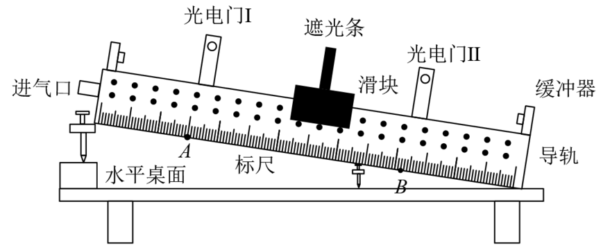

# Physics - 题目 2319

**ID**: 606408650ee6419eb7a4f6dadd28bdcd
**年级**: Grade 12
**难度**: Medium-Hard
**题型**: Experiment

## 题目
为了验证物体沿光滑斜面下滑的过程中机械能守恒，某学习小组用如图所示的气垫导轨装置（包括导轨、气源、光电门、滑块、遮光条、数字毫秒计）进行实验。​​​​​​​‌此外可使用的实验器材还有：天平、游标卡尺、刻度尺。（1）某同学设计了如下的实验步骤，其中不必要的步骤是；①在导轨上选择两个适当的位置A、B安装光电门Ⅰ、Ⅱ，并连接数字毫秒计；②用天平测量滑块和遮光条的总质量m；③用游标卡尺测量遮光条的宽度d；④通过导轨上的标尺测出A、B之间的距离l；⑤调整好气垫导轨的倾斜状态；⑥将滑块从光电门Ⅰ左侧某处，由静止开始释放，从数字毫秒计读出滑块通过光电门Ⅰ、Ⅱ的时间 ${\rm{Δ}}t{{}_{1}}$ 、 ${\rm{Δ}}t{{}_{2}}$ ；⑦用刻度尺分别测量A、B点到水平桌面的高度 $h{{}_{1}}$ 、 $h{{}_{2}}$ ；⑧改变气垫导轨倾斜程度，重复步骤⑤⑥⑦，完成多次测量。（2）用游标卡尺测量遮光条的宽度d时，游标卡尺的示数如图所示，则 $d=$${\rm{m}}{\rm{m}}$ ；某次实验中，测得 ${\rm{Δ}}t{{}_{1}}=11.60{\rm{m}}{\rm{s}}$ ，则滑块通过光电门Ⅰ的瞬时速度 $v{{}_{1}}=$${\rm{m}}{\rm{/}}{\rm{s}}$ （保留3位有效数字）；（3）在误差允许范围内，若 $h{{}_{1}}-h{{}_{2}}=$（用上述必要的实验步骤直接测量的物理量符号表示，已知重力加速度为g），则认为滑块下滑过程中机械能守恒；（4）写出两点产生误差的主要原因：。

## 解答

1. （1）[1]滑块沿光滑的斜面下滑过程机械能守恒，需要通过光电门测量通过滑块运动的速度
2. $v=\frac {d}{Δt}$
3. 滑块下滑过程中机械能守恒，减少的重力势能转化为动能
4. $mg(h{{}_{1}}-h{{}_{2}})=\frac {1}{2}mv{{}_{2}^{2}}-\frac {1}{2}mv{{}_{1}^{2}}=\frac {1}{2}m(\frac {d}{Δt{{}_{2}}}){^{2}}-\frac {1}{2}m(\frac {d}{Δt{{}_{1}}}){^{2}}$
5. 整理化简得
6. $g(h{{}_{1}}-h{{}_{2}})=\frac {1}{2}(\frac {d}{Δt{{}_{2}}}){^{2}}-\frac {1}{2}(\frac {d}{Δt{{}_{1}}}){^{2}}$
7. 所以测量滑块和遮光条得总质量 $m$ 不必要，②满足题目要求，测量 $A$ 、 $B$ 之间的距离 $l$ 不必要，④满足题目要求。
8. 故选②④。
9. （2）[2]游标卡尺的读数为
10. $d=5{\rm{m}}{\rm{m}}+0\times 0.05{\rm{m}}{\rm{m}}=5.00{\rm{m}}{\rm{m}}$
11. [3]滑块通过光电门的速度
12. $v{{}_{1}}=\frac {d}{Δt{{}_{1}}}=\frac {5}{11.60}{\rm{m}}{\rm{/}}{\rm{s}}=0.431{\rm{m}}{\rm{/}}{\rm{s}}$
13. （3）[4]根据（1）问可知
14. $h{{}_{1}}-h{{}_{2}}=\frac {\frac {1}{2}{\left({\frac {d}{Δt{{}_{2}}}}\right)^{2}}-\frac {1}{2}{\left({\frac {d}{Δt{{}_{1}}}}\right)^{2}}}{g}$
15. 在误差允许的范围内，满足该等式可认滑块下滑过程中机械能守恒。
16. （4）[5]滑块在下滑过程中受到空气阻力作用，产生误差；遮光条宽度不够窄，测量速度不准确，产生误差。

## 知识点

**中文**:
  - 实验：验证机械能守恒定律

**English**:
  - Experiment: Verifying Conservation of Mechanical Energy

---
