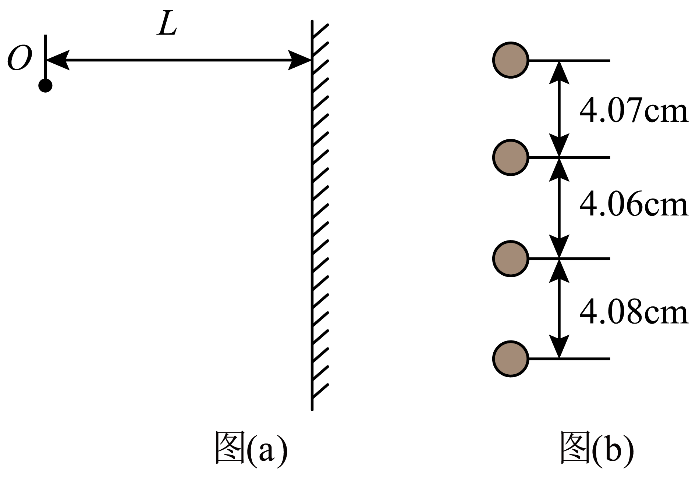

# Physics - 题目 725

**ID**: 62b057f8df644bde9a8aa14c91d3c0fb
**年级**: Grade 12
**难度**: Medium-Hard
**题型**: Experiment

## 题目
物理兴趣小组在进行“探究平抛运动的特点”研究时进行了如下实验。​​​​​​​‌如图（a）所示，小球从O点水平抛出，在该处有一点光源，在抛出点的正前方竖直放置一块毛玻璃，O点与毛玻璃水平距离L=1.00m，小球初速度与毛玻璃平面垂直；小球抛出后在毛玻璃上有小球运动的投影点，利用闪光频率为30Hz的频闪相机记录投影点的位置。当小球以4.0m/s的速度水平抛出时，各投影点实际间距如图（b）所示。（1）小强同学分析频闪照片，他认为在误差范围内，投影点做匀速直线运动，并计算出投影点的速度大小为。（计算结果保留三位有效数字）。（2）小芳同学利用实验数据和小强的计算结果计算出本地的重力加速度，请根据两人的观点计算出重力加速度g=${\rm{m}}{\rm{/}}{\rm{s}}^{{\rm{2}}}$ （计算结果保留三位有效数字）。

## 解答

1. （1）[1]做出平抛运动的图像进行分析，如下图所示
2. 
3. 根据相似三角形，有
4. $\frac {L}{x}=\frac {Y}{y}$
5. 平抛运动在竖直方向上做自由落体运动，在水平方向上做匀速直线运动，上图为任意时刻 $t$ 的图像，则有
6. $y=\frac {1}{2}gt^{2}$ ， $x=v_{0}t$
7. 可得
8. $Y=\frac {y}{x}L=\frac {\frac {1}{2}gt^{2}}{v_{0}t}L=\frac {gL}{2v_{0}}t$
9. 式中 $\frac {gL}{2v_{0}}$ 为定值，则可知小强同学的分析完全正确，投影点在做匀速直线运动，而闪光频率为30Hz，则可知每两个投影之间的时间间隔为
10. $T=\frac {1}{f}=\frac {1}{30}{\rm{s}}$
11. 利用平均速度的求解方法可得投影点的速度大小为
12. $v=\frac {4.07+4.06+4.08}{3T}\times 10^{-2}{\rm{m}}{\rm{/}}{\rm{s}}\approx 1.22{\rm{m}}{\rm{/}}{\rm{s}}$
13. [2]由
14. $Y=\frac {gL}{2v_{0}}t$
15. 得
16. $\frac {(4.07+4.06+4.08)\times 10^{-2}}{3}=\frac {gL}{2v_{0}}\times \frac {1}{30}$
17. 解得
18. $g\approx 9.77{\rm{m}}{\rm{/}}{\rm{s}}^{{\rm{2}}}$

## 知识点

**中文**:
  - 实验：探究平抛运动的特点

**English**:
  - Experiment: Characteristics of Projectile Motion

---
