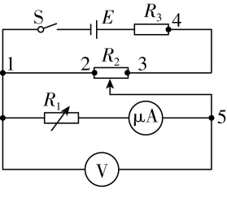

# Physics - 题目 1302

**ID**: 6a018a1729ac491b8bbad376409c09a2
**年级**: Grade 12
**难度**: Medium-Hard
**题型**: 实验题：本题共2小题，共14分。

## 题目
（8分）某同学将一量程为250 μA的微安表改装成量程为1.5 V的电压表。​​​​​​​‌先将电阻箱R_{1}与该微安表串联进行改装，然后选用合适的电源E、滑动变阻器R_{2}、定值电阻R_{3}、开关S和标准电压表对改装后的电表进行检测，设计电路如图所示。（1）微安表铭牌标示内阻为0.8 kΩ，据此计算R_{1}的阻值应为　　　　kΩ。按照电路图连接电路，并将R_{1}调为该阻值。（2）开关闭合前，R_{2}的滑片应移动到　　　　端。（3）开关闭合后，调节R_{2}的滑片位置，微安表有示数，但变化不显著，故障原因可能是　　　　。（填选项前的字母）

## 解答

1. （1）根据电表改装的串并联知识有U＝I_{g}（R_{g}＋R_{1}），故改装电压表时需要串联的R_{1}的阻值为 ${\rm \mathit{R}_{1}＝}\frac{U}{{I}_{\mathrm{g}}}{\rm －\mathit{R}_{g}＝5.2}$  kΩ。
2. （2）R_{2}采用分压式接法，为保护电路，在开关闭合前R_{2}的滑片应移动到最左端。
3. （3）开关闭合后，调节R_{2}的滑片位置，微安表有示数，可判断出3、4间（干路部分）没有断路，3、5间是否短路对电表示数无影响，故障原因可能是1、2间断路，即滑动变阻器变为限流式接法，使得在开关闭合后，调节R_{2}的滑片位置，微安表有示数，但变化不显著。
4. （4）改装后的电表的量程达到预期值时，其内阻为R_{V预期}＝R_{g}＋R_{1预期}＝6 kΩ，而排除故障后，调节R_{2}的滑片位置，当标准电压表的示数为0.60 V时，微安表的示数为98μA，由此可知改装的电表的内阻为 ${\rm \mathit{R}＝}\frac{0.60}{0.098}$  kΩ＝6.12 kΩ＞R_{V}预期，故此时需要减小改装后电表的内阻，即减小R_{1}的阻值，才能使改装电表的量程达到预期值。

## 知识点

**中文**:
  - 其他创新实验

**English**:
  - Other Innovative Experiments

---
