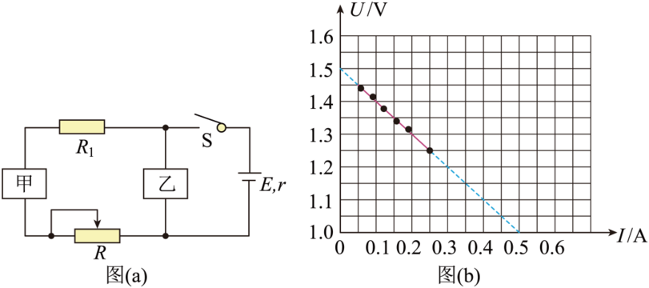

# Physics - 题目 2187

**ID**: 85937de6e5bb47dcb783297fcccfdb6f
**年级**: Grade 12
**难度**: Medium-Hard
**题型**: Experiment

## 题目
某同学做“用DIS测定电源的电动势和内阻”实验，实验电路如图（a）所示。​​​​​​​‌（1）图（a）中乙是传感器，定值电阻R_{1}的作用是。（2）该同学记录了6组实验数据，其中有两组数据是在滑片分别位于滑动变阻器两端时记录的，实验测得的路端电压U与相应电流I的数据描点及拟合曲线如图（b）所示，由此得到电源电动势E=V，内阻r=Ω，定值电阻的阻值R_{1}=Ω。（3）若要使实验过程中，电路的路端电压U的变化范围尽量大一些，从而减小实验误差，下列操作最有效的是(      )

## 解答

1. （1）[1]由实验电路可知，该实验用伏安法测电源电动势和内阻，故乙是电压传感器。
2. [2]定值电阻R_{1}的作用是保护电源，防止短路。
3. （2）[3][4]由闭合电路欧姆定律
4. $E=U+Ir$
5. 可得
6. $U=E-rI$
7. 所以图（b）中图线的纵截距即为电源电动势，图线的斜率即为电源内阻
8. $E=1.5{\rm{V}}$
9. $r=\frac {1.5-1.0}{0.5}Ω=1Ω$
10. [5]当滑动变阻器的阻值为零时，路端电压U最小，由图（b）可知，此时
11. $I=0.25{\rm{A}}$ ， $U=1.25{\rm{V}}$
12. 所以定值电阻的阻值
13. $R_{1}=\frac {U}{I}=\frac {1.25}{0.25}Ω=5Ω$
14. （3）[6]由图（b）可知，本实验所测路端电压范围偏高，故要增大电压U的变化范围需减小路端电压U的最小值，故需减小定值电阻R_{1}的阻值，故C正确。
15. 故选C。

## 知识点

**中文**:
  - 实验：电池电动势和内阻的测量—伏安法测量电源电动势与内阻

**English**:
  - V-A Method for EMF and Internal Resistance

---
