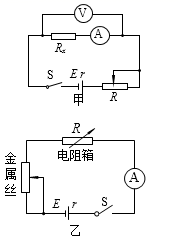
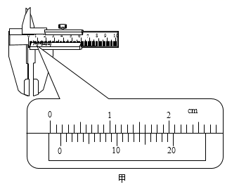
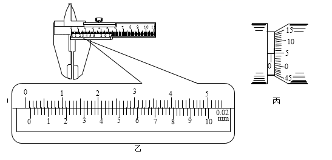
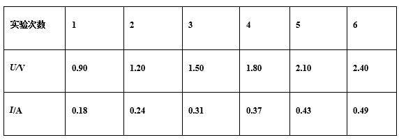
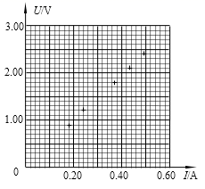
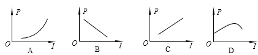
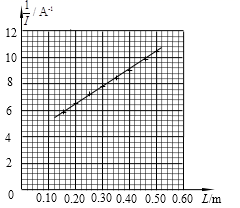

# Physics - 题目 592

**ID**: 85b94f4ee46c4665be4fb3b2d27d8ba3
**年级**: Grade 12
**难度**: Medium-Hard
**题型**: Experiment

## 题目
为测量某金属丝的电阻率，小明同学设计了如图甲、乙所示的两种实验方案，已知电源的电动势E和内阻r在实验过程中保持不变。​​​​​​​‌(1)小明先进行了如图甲方案的测量。①他首先利用游标卡尺和螺旋测微器分别测出甲、乙、丙三根不同金属丝的直径，示数分别如图甲、乙、丙所示。则三根金属丝直径的测量值分别为d_{甲}=mm、d_{乙}=mm、d_{丙}=mm。若三根金属丝的材料、长度相同且粗细均匀，则它们的电阻R_{甲}、R_{乙}和R_{丙}中最大的是，最小的是。②实验过程中，小明先将甲金属丝接入电路，并用米尺测出接入电路中的甲金属丝的长度l=50.00cm。闭合开关后移动滑动变阻器的滑片分别处于不同的位置，并依次记录了两电表的测量数据如下表所示，其中5组数据的对应点他已经标在如图所示的坐标纸上，请你标出余下一组数据的对应点，并画出U-I图线。③该方案测得的甲金属丝的电阻率ρ_{甲}=Ω·m（计算结果保留两位有效数字）。④对于上述第(1)所述的测量过程，随着通过金属丝的电流I不断增大，滑动变阻器上的电功率P随之变化。对于P-I的关系图象，在下列图中可能正确的是（）(2)小明又用如图乙方案测量乙金属丝的电阻率，已知电源的电动势E=5.0V、内阻r=0.20Ω。实验中他可以通过改变接线夹（即图乙中滑动变阻器符号上的箭头）接触金属丝的位置以控制接入电路中金属丝的长度。①请在下述步骤的空格中将实验操作步骤补充完整：a．正确连接电路，设定电阻箱的阻值，闭合开关；b．读出电流表的示数，记录接线夹的位置；c．断开开关，；d．闭合开关，重复b、c的操作。②根据测得电流与金属丝接入长度关系的数据，绘出如图所示的关系图线，其斜率为A^{-1}∙m^{-1}（保留2位有效数字）；图线纵轴截距与电源电动势的乘积代表了的电阻之和。③图中图线的斜率、电源电动势和金属丝横截面积的乘积代表的物理量是，其数值和单位为（保留2位有效数字）。(3)电表的内阻可能对实验产生系统误差，请你分别就这两种方案说明电表内阻对电阻率测量的影响。

## 解答

1. (1)①[1]金属丝甲的直径
2. $d{{}_{甲}}=1{\rm{m}}{\rm{m}}+0.05\times 15{\rm{m}}{\rm{m}}=1.75{\rm{m}}{\rm{m}}$
3. [2]金属丝乙的直径
4. $d{{}_{乙}}=1{\rm{m}}{\rm{m}}+0.02\times 18{\rm{m}}{\rm{m}}=1.36{\rm{m}}{\rm{m}}$
5. [3]金属丝丙的直径
6. $d{{}_{丙}}=0.5{\rm{m}}{\rm{m}}+0.046{\rm{m}}{\rm{m}}=0.546{\rm{m}}{\rm{m}}$
7. [4][5]根据电阻定律的决定式
8. $R=ρ\frac {l}{S}{\rm{=}}ρ\frac {4l}{πd{^{2}}}$
9. 可知
10. $R{{}_{甲}}$  最小， $R{{}_{丙}}$ 最大
11. ②[6]图象如图所示
12. 
13. ③[7]根据图象可知电阻值
14. $R{{}_{甲}}=\frac {U}{I}=4.92{\rm{Ω}}$
15. 再根据电阻定律
16. $R=ρ\frac {l}{S}{\rm{=}}ρ\frac {4l}{πd{^{2}}}$
17. 代入数据，解得
18. $ρ=2.4\times 10{^{-5}}Ω\cdot {\rm{m}}$
19. ④[8]随电流增大，滑动变阻器的功率先变大后变小，当滑动变阻器阻值等于其它电阻之和时，功率最大，D正确，ABC错误。
20. 故选D。
21. (2)①[9] 测出接入电路的金属丝的长度。
22. ②[10]由图象可得斜率为13 A^{-1}∙m^{-1}。
23. [11][12]根据
24. $I=\frac {E}{rl+R}$
25. 整理得
26. $\frac {1}{I}=\frac {r}{E}l+\frac {R}{E}$
27. 其中 $r$ 就是单位长度的电阻，根据电阻定律
28. $r=\frac {ρ}{S}$
29. 代入整理得
30. $\frac {1}{I}=\frac {ρ}{ES}l+\frac {R}{E}$
31. 因此图线纵轴截距与电源电动势的乘积代表电源内阻、电流表内电阻与电阻箱电阻之和；斜率、电源电动势和金属丝横截面积的乘积代表的金属丝的电阻率。
32. ③[13]将电源电动势E和乙金属丝的直径d_{乙}代入得
33. $ρ=13\times 5.0\times π\times (\frac {1.36\times 10{^{-3}}}{2}){^{2}}{\rm{Ω}}\cdot {\rm{m}}=9.4\times 10{^{-5}}{\rm{Ω}}\cdot {\rm{m}}$
34. （3）[14] 图甲方案，由于电流表的分压作用，导致电压表测量值偏大，电阻的测量值偏大，电阻率测量值偏大；图乙方案中电表内阻对测量结果没有影响。

## 知识点

**中文**:
  - 实验：导体电阻率的测量

**English**:
  - Experiment: Measuring Resistivity

---
