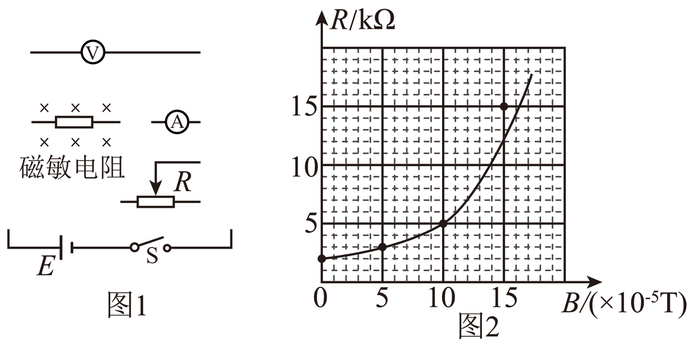
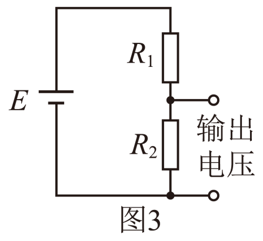

# Physics - 题目 510

**ID**: 983b770649bd4ebe82ee1334ccae73b9
**年级**: Grade 12
**难度**: Medium-Hard
**题型**: Experiment

## 题目
磁敏电阻是一种对磁敏感，具有磁阻效应的电阻元件。​​​​​​​‌磁敏电阻在磁场中电阻值发生变化的现象称为磁阻效应。某同学利用伏安法测量一磁敏电阻的阻值（约几千欧）随磁感应强度的变化关系。所用器材：电源E、开关S，滑动变阻器R（最大阻值为20Ω），电压表（内阻约为3000Ω）和毫安表（可视为理想电表）。（1）在图1所给的器材符号之间画出连线，组成测量电路图；（2）实验时，将磁敏电阻置于待测磁场中，记录不同磁感应强度下电压表和毫安表的示数，计算出相应的磁敏电阻阻值。若某次测量中电压表和毫安表的示数分别为6.2V和2.8mA，则此时磁敏电阻的阻值为kΩ（保留2位有效数字）。实验中得到的该磁敏电阻阻值R随磁感应强度B变化的曲线如图2所示；（3）某次测量中，测得磁敏电阻的阻值为10.0kΩ，此时磁感应强度为T（保留2位有效数字）；（4）太阳风是指从太阳上层大气射出的超声速带电粒子流，当太阳风激烈爆发时，可能会给地球带来无法预计的磁暴灾难。某同学利用实验中的磁敏电阻制作了一种搭载在人造卫星上的探测磁感应强度的报警器，其电路的一部分如图3所示。图中E为直流电源（电动势为9.0V，内阻可忽略），当图中的输出电压达到或超过3.0V时，便触发报警器（图中未画出）报警。若要求开始报警时磁感应强度为 $10{^{-4}}{\rm{T}}$ ，则图中（填“ $R{{}_{1}}$ ”或“ $R{{}_{2}}$ ”）应使用磁敏电阻，另一固定电阻的阻值应为kΩ（保留2位有效数字）；如果要提高此装置的灵敏度（即在磁感应强度更小时就能触发报警），应该（填“增大 $R{{}_{1}}$ ”或“减小 $R{{}_{1}}$ ”）。

## 解答

1. （1）因毫安表可视为理想电表，则可以采用伏安法的内接法可以消除电流表内阻而产生的系统误差；滑动变阻器的总阻值为20Ω，待测磁敏电阻约几千欧，属于小电阻控制大电阻，则用滑变的分压式接法便于操作和多测数据，电路图如图所示
2. 
3. （2）根据部分电路的欧姆定律可得磁敏电阻的阻值为 $R=\frac {U}{I}=\frac {6.2}{2.8\times 10{^{-3}}}Ω\approx 2.2{\rm{k}}Ω$
4. （3）根据 $R-B$ 图像可知，当 $R=10.0{\rm{k}}{\rm{Ω}}$ 时，磁感应强度 $B\approx 1.4\times 10{^{-4}}{\rm{T}}$ ；
5. （4）根据闭合电路可得输出电压为 $U=\frac {ER{{}_{2}}}{R{{}_{1}}+R{{}_{2}}}$ ，要求输出电压达到或超过3.0V时报警，即要求磁感应强度增大时，电阻的阻值增大，从而需要输出电压增大，需要 $R{{}_{2}}$ 的阻值增大才能实现此功能， $R{{}_{2}}$ 为磁敏电阻；
6. 已知报警电压为 $U=3{\rm{V}}$ ，而 $B=10{^{-4}}{\rm{T}}$ 时， $R{{}_{2}}=5{\rm{k}}{\rm{Ω}}$ ，各数据解得 $R{{}_{1}}=\frac {ER{{}_{2}}}{U}-R{{}_{2}}=10{\rm{k}}{\rm{Ω}}$
7. 在磁感应强度更小时 $R{{}_{2}}$ 的阻值较小，根据串联分压原理可知将R_{1}减小，从而让 $R{{}_{2}}$ 分得更多的电压，达到3V就可以报警，即如果要提高此装置的灵敏度，应该减小 $R{{}_{1}}$ 。

## 知识点

**中文**:
  - 实验：传感器相关探究与实验

**English**:
  - Experiment: Sensor Related Inquiry and Experiments

---
