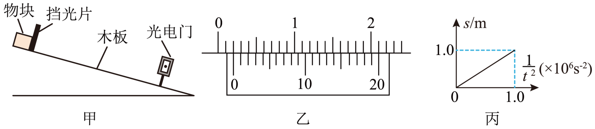

# Physics - 题目 1062

**ID**: 9a1676de920d40c7af57081ad2c4844b
**年级**: Grade 12
**难度**: Medium-Hard
**题型**: Experiment

## 题目
某同学用如图甲所示的装置测量物块与木板间的动摩擦因数。​​​​​​​‌（1）用游标卡尺测量挡光片的宽度，其示数如图乙所示，则挡光片的宽度d=mm。（2）使物块每次都从斜面上的A点由静止滑下，改变光电门的位置B，测量A、B之间的距离s，并记下相应的挡光时间t，获得多组数据。若以s为纵轴、 $\frac {1}{t{{}^{2}}}$ 为横轴作出的 $s-\frac {1}{t{{}^{2}}}$ 图像如图丙所示，则物块的加速度大小a=m/s^{2}（结果保留两位有效数字）。（3）若测得木板的倾角为 $30{{}^{\circ }}$ ，取重力加速度大小g=10m/s^{2}，结合（1）、（2）的结果，则物块与木板间的动摩擦因数μ=（结果保留两位有效数字）。

## 解答

1. （1）[1]根据游标卡尺的读数规律，该读数为
2. $2mm+0.05\times 0mm=2.00mm$
3. （2）[2]物块通过光电门的速度
4. $v=\frac {d}{t}$
5. 根据
6. $v{{}^{2}}=2as$
7. 解得
8. $s=\frac {d{{}^{2}}}{2a}\cdot \frac {1}{t{{}^{2}}}$
9. 结合图丙有
10. $\frac {d{{}^{2}}}{2a}=\frac {1.0}{1.0\times 10{{}^{6}}}$
11. 解得
12. $a=2.0m/s{{}^{2}}$
13. （3）[3]根据
14. $mg{\sin}θ-{\rm μm}g{\cos}θ=ma$
15. 解得
16. $μ\approx 0.35$

## 知识点

**中文**:
  - 创新实验—测量动摩擦因数

**English**:
  - Measuring Coefficient of Kinetic Friction

---
