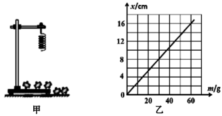
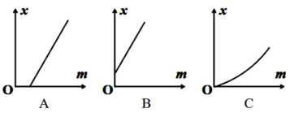

# Physics - 题目 340

**ID**: 9b945744ed2d46f1a6852c4def751c56
**年级**: Grade 12
**难度**: Medium-Hard
**题型**: Experiment

## 题目
如图甲所示，同学A用铁架台、弹簧和多个已知质量且质量相等的钩码，探究在弹性限度内弹簧弹力与弹簧伸长长度的关系实验．(1)实验中还需要的测量工具有：．(2)如图乙所示，根据实验数据绘图，纵轴是弹簧的形变量x，横轴是钩码质量m，由图可知弹簧的劲度系数 $k=$N/m（计算结果保留2位有效数字，重力加速度g取9.​​​​​​​‌8m/s^{2}）．(3)同学B在做该实验时，他先把弹簧平放在水平桌面上使其自然伸长，测出弹簧的原长L_{0}，再把弹簧竖直悬挂起来，挂上钩码后测出弹簧伸长后的长度L，把L－L_{0}作为弹簧的形变量x，这样操作，由于弹簧自身重力的影响，最后画出的图线可能是下图中的．

## 解答

1. (1)[1]实验需要测量弹簧伸长的长度，故需要的测量工具有刻度尺；
2. (2)[2].图线的物理意义是表明弹簧的弹力大小和弹簧伸长量大小成正比，根据胡克定律可知，弹簧的劲度系数为：
3. $k=\frac {ΔF}{Δx}=\frac {0.06\times 9.8}{0.16}{\rm{N}}{\rm{/}}{\rm{m}}=3.7{\rm{N}}{\rm{/}}{\rm{m}}$
4. (3)[3]由于弹簧自身的重力会使得没有挂重物时，弹簧有伸长，所以当 $F=0$ 时， $x$ 大于零；
5. A. 与分析不符，故A错误；
6. B. 与分析相符，故B正确；
7. C. 与分析不符，故C错误．

## 知识点

**中文**:
  - 实验：探究弹簧弹力和形变量的关系

**English**:
  - Experiment: Investigating Spring Force vs Deformation

---
