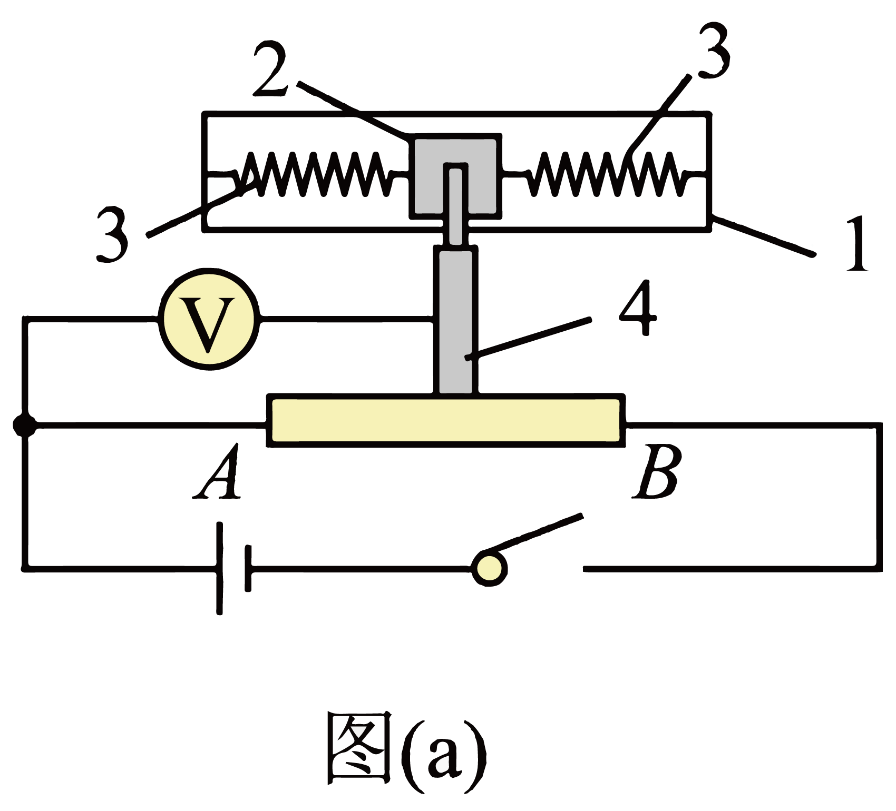
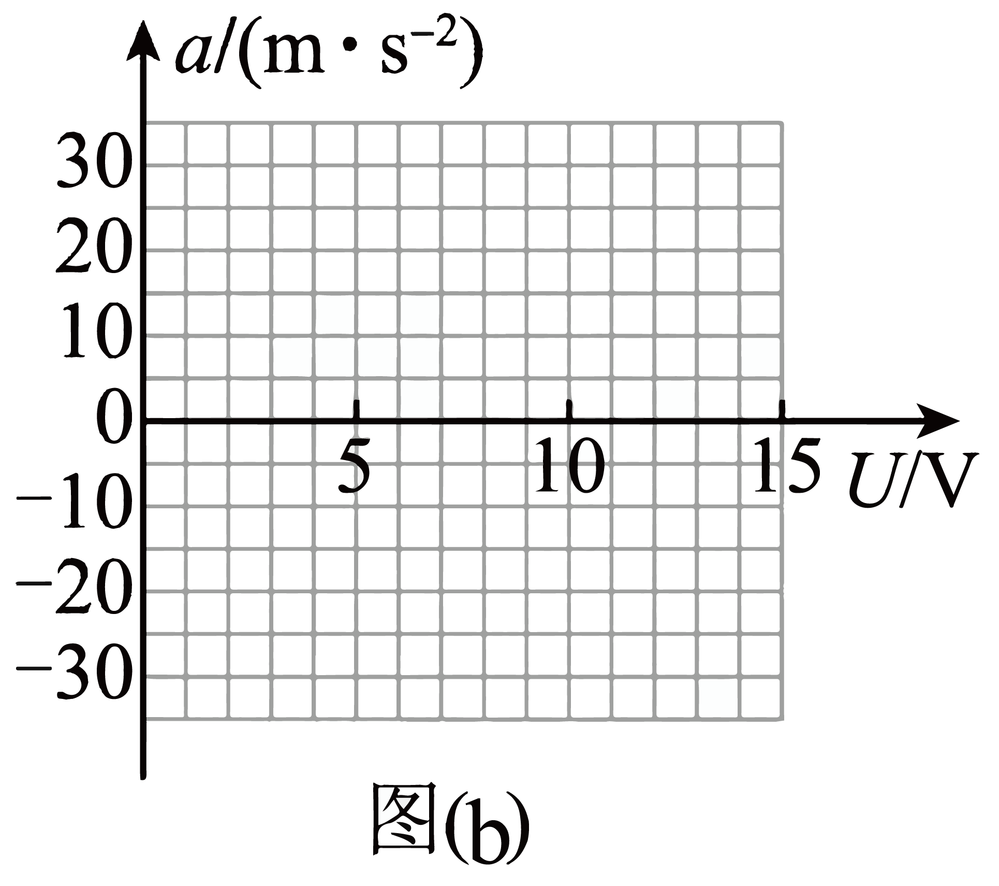

# Physics - 题目 499

**ID**: a5e578fbc4c04257b06c0648a5eb21e8
**年级**: Grade 12
**难度**: Medium-Hard
**题型**: Experiment

## 题目
某同学设计了一个加速度计，将其固定在待测物体上，能通过电路中电压表的示数反映物体的加速度a，其原理图如图（a）所示。​​​​​​​‌其中，质量 $m=1{\rm{k}}{\rm{g}}$ 的滑块2可以在光滑的框架1中左右平移，滑块两侧各连接一根劲度系数 $k=2.0\times 10{^{2}}{\rm{N}}{\rm{/}}{\rm{m}}$ 的轻质弹簧3（弹簧始终处于弹性限度内）。4是固定在滑块2上的轻质金属滑片（宽度不计），与电压表的一端用导线相连，并与一阻值均匀的电阻AB相接触，滑片4与电阻间的摩擦忽略不计。已知物体加速度为0时，两侧弹簧3均处于原长，滑片4位于AB中点，AB全长 $L=15{\rm{c}}{\rm{m}}$ ；直流电源电动势 $E=15{\rm{V}}$ （内阻忽略不计）。现有一量程0~3V、内阻 $R{{}_{{\rm{v}}}}=3{\rm{k}}{\rm{Ω}}$ 的电压表（ $R{{}_{{\rm{v}}}}\gg R{{}_{AB}}$ ）；另有开关、导线若干。（1）为使滑片4位于B点时电压表满偏，需要将电压表量程改为0~15V，则电压表应（选填“串联”或“并联”）一个阻值为${\rm{k}}\Omega $ 的电阻；（2）将改装后的电压表接入图（a）的电路中，此装置可测量加速度的最大值为m/s^{2}；（3）请在图（b）中画出 $a-U$ 图像（规定加速度向左为正方向，U为改装后电压表的示数）；（4）若要增大加速度的测量范围，可采用的方法有：（答出一条合理措施即可）。

## 解答

1. （1）根据串联电路的特点，要增大电压表的量程，需要串联一个定值电阻，根据分压原则可得 $\frac {U{{}_{{\rm{V}}}}}{R{{}_{{\rm{V}}}}}=\frac {E-U{{}_{{\rm{V}}}}}{R}$ ，代入数据解得 $R=12{\rm{k}}{\rm{Ω}}$
2. （2）对滑块受力分析可得 $2k\centerdot \frac {L}{2}=ma$ ，解得 $a=\frac {2k\centerdot \frac {L}{2}}{m}=\frac {2\times 10{^{2}}\times 15\times 10{^{-2}}}{1}{\rm{m}}{\rm{/}}{\rm{s}}{^{{{2}}}}=30{\rm{m}}{\rm{/}}{\rm{s}}{^{{{2}}}}$
3. （3）根据 $2k\centerdot \frac {L}{2}=ma$ 可知加速度与成线性关系，根据串联电路分压规律可知电压表示数 $U$ 与 $L$ 也成线性关系，可知加速度 $a$ 与电压表示数 $U$ 是线性关系，当滑块处于中点时，电压表示数为7.5V，当加速度向右时，滑块在中点的左边，当加速度向左时，滑块在中点的右边，所以 $a-U$ 图像如图所示
4. 
5. （4）滑块所受到的合力最大值由弹簧决定的，与电压无关，劲度系数越大，加速度的测量范围越大；最大的合力一定的情况下，根据牛顿第二定律可知，减小滑块的质量，可以增大加速度的测量范围。

## 知识点

**中文**:
  - 生活中的传感器

**English**:
  - Sensors in Daily Life

---
