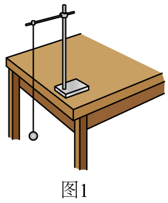

# Physics - 题目 1373

**ID**: ab70ada2d7c5463dbcb4d321c8bde588
**年级**: Grade 12
**难度**: Medium-Hard
**题型**: Experiment

## 题目
物理实验一般都涉及实验目的、实验原理、实验仪器、实验方法、实验操作、数据分析等。​​​​​​​‌（1）如图所示，某同学在“用单摆测重力加速度”实验中，有如下步骤：

## 解答

1. （1）[1][2]摆长应等于摆线长与摆球半径之和，故错误的是A；摆球应选用体积小、密度大，不必测量质量，故不必要的是C。
2. （2）[3][4]水平方向
3. $2L=v{{}_{0}}T$
4. 竖直方向
5. $3L-2L=gT{{}^{2}}$
6. 小球通过相邻位置的时间间隔为
7. $T=\sqrt {\frac {L}{g}}$
8. 小球平抛的初速度为
9. $v{{}_{0}}=2\sqrt {gL}$
10. （3）[5]根据
11. $mg=\left ({M+m}\right )a$
12. 得
13. $\frac {1}{a}=\frac {1}{mg}M+\frac {1}{g}$
14. 可知，图像与纵轴截距等于重力加速度的倒数，故该同学的观点是错误的。

## 知识点

**中文**:
  - 实验：用单摆测量重力加速度

**English**:
  - Experiment: Measuring g with Simple Pendulum

---
