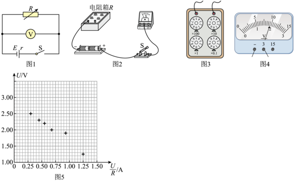
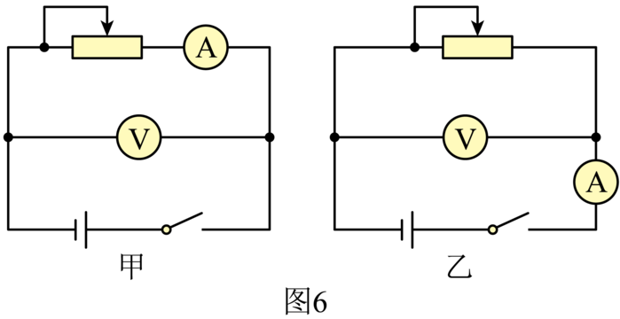

# Physics - 题目 1077

**ID**: b1146ec6f9a3483b86bfdfd2f6542b0b
**年级**: Grade 12
**难度**: Medium-Hard
**题型**: Experiment

## 题目
关于“测电源的电动势和内阻”实验，某研究性学习小组的同学用如图1所示的电路，测量两节干电池串联而成的电池组的电动势E和内电阻r。​​​​​​​‌实验室提供的器材如下：待测电池、电压表、电阻箱（阻值范围0~999.9Ω）、开关、导线。（1）请根据图1所示的电路图，在图2中画出连线，将器材连接成实验电路。（2）开始做实验时，先把变阻箱阻值调到最大，再接通开关，然后逐次改变电阻箱接入电路的阻值R，读取与R对应的电压表的示数U，并将相应的数据转化为坐标点描绘在U‒ $\frac {U}{R}$ 图中。请将图3、图4中电阻箱和电压表所示的数据转化为坐标点描绘在图5所示的坐标系中（用“+”表示），并画出 $U-\frac {U}{R}$ 图线。（3）由 $U-\frac {U}{R}$ 图线可得该电池组的电动势E=V，内电阻r=Ω。（均保留3位有效数字）（4）若利用电流表、电压表来测量一节新的干电池的电动势和内电阻，要求尽量减小实验误差，图6中甲、乙两种连接方案应该选择哪一种，并说明理由：。

## 解答

1. （1）[1] 实物连接图如下
2. 
3. （2）[2]  $U-\frac {U}{R}$ 图象如下图
4. 
5. （3）[3] 根据闭合电路的欧姆定律可得
6. $U=-\frac {U}{R}r+E$
7. 可知，图象与纵轴的交点表示电源的电动势，故电动势为
8. $E=2.93{\rm{V}}$ （2.85~3.00V之间均可）
9. [4] 图象的斜率表示内阻，可得
10. $r=\frac {2.93-1.00}{1.45}{\rm{Ω}}=1.33{\rm{Ω}}$ （1.25~1.40Ω之间均可）
11. （4）[5] 应该选用甲方案。甲方案的误差在电压表分流，但由于电压表内阻很大，所以由于电压表分流而产生的误差较小；乙方案的误差在电流表分压，但是电流表内阻较小，和一节新干电池的内阻相差不多，此时由于电流表分压而产生的误差较大，会导致该方案中电源内阻的测量值误差较大，综合比较，故选甲方案误差较小。

## 知识点

**中文**:
  - 实验：电池电动势和内阻的测量—伏阻法测定电源的电动势与内阻

**English**:
  - V-R Method for EMF and Internal Resistance

---
