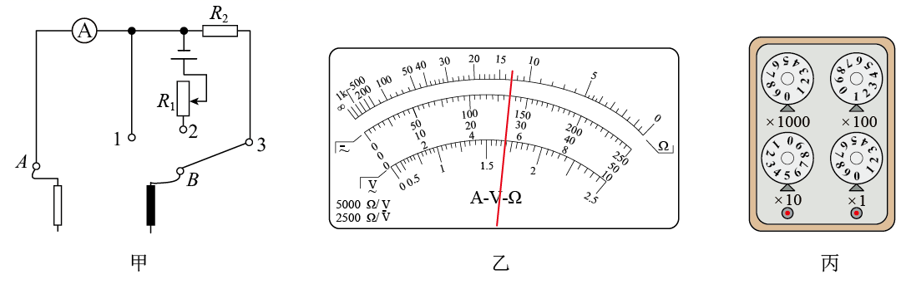

# Physics - 题目 2230

**ID**: cbe6758fa829433fb3b8a0bcef51b070
**年级**: Grade 12
**难度**: Medium-Hard
**题型**: Experiment

## 题目
某物理兴趣小组选用内阻 $R{{}_{{\rm{g}}}}=10{\rm{Ω}}$ 、满偏电流 $I{{}_{{\rm{g}}}}=10{\rm{m}}{\rm{A}}$ 的电流表、标识不清的电源，以及定值电阻、导线、滑动变阻器等组装成了一个多用电表，其结构如图甲。​​​​​​​‌当选择开关接“3”时为量程250V的电压表，该多用电表表盘如图乙所示，下排刻度均匀，上排刻度线对应数值还没有及时标出。(1)其中电阻 $R{{}_{2}}=$Ω；(2)兴趣小组在实验室找到了一个电阻箱，利用组装好的多用电表设计了如下从“校”到“测”的实验：①将选择开关接“2”，红黑表笔短接，调节 $R{{}_{1}}$ 的阻值使电表指针满偏；②将多用电表红黑表笔与电阻箱相连，调节电阻箱使多用电表指针指在电表刻度盘中央C处．此时电阻箱如图丙所示，则C处刻度线的标注值应为Ω，此多用电表中所用电源的电动势为V；③用待测电阻 $R{{}_{x}}$ 代替电阻箱接人两表笔之间，表盘指针指在图乙中所示的位置，则可知待测电阻为 $R{{}_{x}}=$Ω；（保留三位有效数字）④小组成员随手拿来一块电压表，将两表笔分别触碰电压表的两接线柱，发现电压表读数为1.35V，可求得该电压表内阻为Ω。

## 解答

1. (1)[1]由题可知，当选择开关接“3”时为量程 250V的电压表，根据欧姆定有
2. $U=I{{}_{{\rm{g}}}}(R{{}_{{\rm{g}}}}+R{{}_{2}})$
3. 可得
4. $R{{}_{2}}=\frac {U}{I{{}_{{\rm{g}}}}}-R{{}_{{\rm{g}}}}=\frac {250}{10\times 10{^{-3}}}{\rm{Ω}}-10{\rm{Ω}}=24990{\rm{Ω}}$
5. (2)[2]C处为表盘的中央刻度，所以C处刻度所对应的电阻为中值电阻，也即欧姆表的内电阻，由图丙可得电阻箱的示数为
6. $0\times 1000{\rm{Ω}}+1\times 100{\rm{Ω}}+5\times 10{\rm{Ω}}+0\times 1{\rm{Ω}}=150{\rm{Ω}}$
7. 也即C处刻度线的标注值应为150Ω；
8. [3]由题意可知内置电源的电动势为
9. E=150×0.01V=1.5V
10. [4]指针指在图乙所示的位置时，流过待测电阻的电流为6.9mA，根据闭合电路欧姆定律有
11. $E=I(R{{}_{{\rm{x}}}}+R{{}_{内}})$
12. 代入数据可得R_{x}=67.4Ω
13. [5]当电压表的示数为1.35V时，根据分压原理有
14. $\frac {E-U}{R{{}_{内}}}=\frac {U}{R{{}_{{\rm{V}}}}}$
15. 代入数据有
16. $\frac {1.50-1.35}{150}=\frac {1.35}{R{{}_{{\rm{v}}}}}$
17. 得 $R{{}_{v}}=1350{\rm{Ω}}$

## 知识点

**中文**:
  - 实验：练习使用多用电表

**English**:
  - Experiment: Using a Multimeter

---
