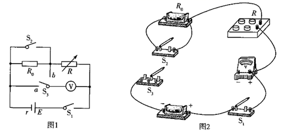
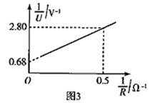

# Physics - 题目 431

**ID**: d21dcf9b7abb4a8cbf3e8be23690fea0
**年级**: Grade 12
**难度**: Medium-Hard
**题型**: Experiment

## 题目
某同学为测量一节新干电池的电动势和内阻，根据实验室提供的器材，设计了如图1所示的电路，其中R_{0}是阻值大约为几欧姆的定值电阻，S_{3}为单刀双掷开关。​​​​​​​‌（1）请根据图1电路图将图2的实物图连接完整；（2）实验开始前，先将电阻箱接入电路的电阻值调节到适当大的值，断开开关S_{2}，将S_{3}合向a，再将开关S_{1}闭合，记录电压表的示数为U_{1}，电阻箱接入电路的电阻为R_{1}=20 Ω；再闭合开关S_{2}，调节电阻箱接入电路的阻值，当电压表的示数再次为U_{1}时，电阻箱接入电路的阻值改变了5Ω，则此时电阻箱接入电路的阻值R=Ω，定值电阻R_{0}=Ω；（3）断开开关S_{2}，将开关S_{3}合向b，多次改变电阻箱接入电路的电阻值，记录电阻箱接入电路的电阻值R及相应的电压表的示数U，在 $\frac {1}{U}-\frac {1}{R}$ 坐标系中描点作图，作出的图象如图3所示，则电池的电动势为E=V，电池内阻r=Ω(结果均保留三位有效数字)。

## 解答

1. （1）根据电路图，连接实物图如图所示。
2. 
3. （2）闭合开关 ${\rm{S}}{{}_{2}}$ ，电路中的电阻减小，电流增大，外电压减小，电压表的示数变小，应将电阻箱接入电路的电阻增大，因此当电压表的示数再次为 $U{{}_{1}}$ 时，由题意知，电阻箱接入电路的电阻为25Ω；
4. 定值电阻
5. $R{{}_{0}}=R{{}_{2}}–R{{}_{1}}=5Ω$ ；
6. （3）根据闭合电路欧姆定律，
7. $E=\frac {U}{R}\left ({R{{}_{0}}+r}\right )+U$ ，
8. 得到
9. $\frac {1}{U}=\frac {R{{}_{0}}+r}{E}\cdot \frac {1}{R}+\frac {1}{E}$ ，
10. 结合图象有
11. $\frac {1}{E}=0.68$ ，
12. 解得
13. $E\approx 1.47{\rm{V}}$ ；
14. 根据 $\frac {1}{U}-\frac {1}{R}$ 的表达式，结合图像有：
15. $\frac {R{{}_{0}}+r}{E}=\frac {2.80-0.68}{0.5}$
16. 解得：
17. $r\approx 1.24Ω$ （或 $1.23Ω$ ）。

## 知识点

**中文**:
  - 实验：电池电动势和内阻的测量—伏阻法测定电源的电动势与内阻
  - 闭合电路的欧姆定律及其应用

**English**:
  - V-R Method for EMF and Internal Resistance
  - Ohm's Law for Closed Circuits and Applications

---
