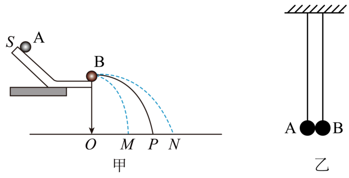

# Physics - 题目 234

**ID**: d48507215e9244a08e776a851fe1a3bd
**年级**: Grade 12
**难度**: Medium-Hard
**题型**: Experiment

## 题目
利用如图甲所示的装置可以验证动量守恒定律，O点是小球抛出点在地面上的垂直投影，实验时先让质量较大的入射小球A多次从斜槽上位置S由静止释放，通过白纸和复写纸找到其平均落地点的位置P，测出水平射程OP。​​​​​​​‌然后，把大小相同，质量较小的被碰小球B静置于轨道末端，仍将甲入射小球A从斜槽上位置S由静止释放，与被碰小球B相碰，多次重复该操作，两小球平均落地点位置分别为M、N。（1）关于本实验，下列说法中正确的是。

## 解答

1. （1）[1]ABC．在实验中，要保证两小球发生对心正碰，所以两小球半径相等，且小球离开斜槽应做平抛运动，所以斜槽末端切线水平，但不需要斜槽光滑，故AB正确，C错误；
2. D．在同一组实验中，由于实验存在误差，所以小球B的落点并不重合，不能说明操作中出现错误，故D错误。
3. 故选AB。
4. （2）[2]两小球在碰撞过程中有
5. $m{{}_{{\rm{A}}}}v{{}_{0}}=m{{}_{{\rm{A}}}}v{{}_{1}}+m{{}_{{\rm{B}}}}v{{}_{2}}$
6. $v{{}_{0}}=\frac {OP}{t}$
7. $v{{}_{1}}=\frac {OM}{t}$
8. $v{{}_{2}}=\frac {ON}{t}$
9. 由于小球从相同高度做平抛运动，所以下落时间相等，所以
10. $m{{}_{{\rm{A}}}}\cdot OP=m{{}_{{\rm{A}}}}\cdot OM+m{{}_{{\rm{B}}}}\cdot ON$
11. 即需要用天平测量小球的质量，刻度尺测量O点到平均落点的距离。
12. 故选AC。
13. （3）[3]由以上分析可知，在实验误差允许范围内，两球碰撞前后在OP方向上动量守恒，应满足的关系
14. $m{{}_{{\rm{A}}}}\cdot OP=m{{}_{{\rm{A}}}}\cdot OM+m{{}_{{\rm{B}}}}\cdot ON$
15. （4）[4]本实验中应将A球向左拉起，测量轻绳与竖直方向的夹角θ，并将A球由该位置静止释放，两球在最低点发生碰撞，然后测量碰后A球反弹到最大高度时轻绳与竖直方向的夹角α，B球上升到最大高度时轻绳与竖直方向的夹角β，根据机械能守恒定律有
16. $m{{}_{{\rm{A}}}}gL(1-{\cos}θ)=\frac {1}{2}m{{}_{{\rm{A}}}}v{{}_{0}^{2}}$
17. $m{{}_{{\rm{A}}}}gL(1-{\cos}α)=\frac {1}{2}m{{}_{{\rm{A}}}}v{{}_{1}^{2}}$
18. $m{{}_{{\rm{B}}}}gL(1-{\cos}β)=\frac {1}{2}m{{}_{{\rm{B}}}}v{{}_{2}^{2}}$
19. 根据动量守恒定律有
20. $m{{}_{{\rm{A}}}}v{{}_{0}}=m{{}_{{\rm{B}}}}v{{}_{2}}-m{{}_{{\rm{A}}}}v{{}_{1}}$
21. 即
22. $m{{}_{{\rm{A}}}}\sqrt {1-{\cos}θ}=m{{}_{{\rm{B}}}}\sqrt {1-{\cos}β}-m{{}_{{\rm{A}}}}\sqrt {1-{\cos}α}$

## 知识点

**中文**:
  - 研究斜槽末端小球碰撞时的动量守恒

**English**:
  - Momentum Conservation in Collision at End of Inclined Ramp

---
