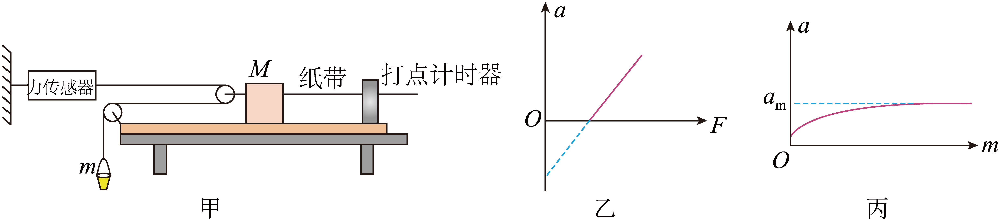

# Physics - 题目 614

**ID**: d5a72ec5dba9451f98ac9e39622d6132
**年级**: Grade 12
**难度**: Medium-Hard
**题型**: Experiment

## 题目
某实验小组为了测定小物块与长木板间的动摩擦因数，设计了如图甲所示的实验装置，力传感器可以测出轻绳的拉力大小，滑轮及轻绳质量不计，重力加速度g已知。​​​​​​​‌实验步骤如下：①按图甲所示装置安装实验器材，图中长木板保持水平；②在砂桶内放入一定质量的砂子，小物块靠近打点计时器，接通打点计时器的电源，释放小物块，打出一条纸带，同时记录力传感器的读数；③利用纸带计算小物块的加速度；④改变砂桶内砂子的质量，重复步骤②③；⑤以小物块加速度a为纵坐标，力传感器读数F为横坐标，作出图像如图乙所示。（1）测得图乙中直线斜率为k，纵截距为 $-b$ ，则长木板动摩擦因数为；小物块质量为（用k、b、g表示）；（2）先将长木板倾斜一定角度以平衡摩擦力，然后多次改变砂桶内砂子的质量，作出小车加速度a与砂和砂桶总质量m的图线如图丙所示，则图中 $a_{m}$ 的值为。

## 解答

1. （1）[1][2]对车运用牛顿第二定律有
2. $2F-μMg=Ma$
3. 变形可得
4. $a=\frac {2}{M}F-μg$
5. 则有
6. $k=\frac {2}{M}$ ， $b=μg$
7. 解得
8. $μ=\frac {b}{g}$ ， $M=\frac {2}{k}$
9. （2）[3]分别对砂桶和小车使用牛顿第二定律，可得
10. $mg-F=2ma$
11. $2F=Ma$
12. 联立解得
13. $a=\frac {g}{2+\frac {M}{2m}}$
14. 当m远大于M时，则有
15. $a_{{\rm{m}}}=\frac {g}{2}$

## 知识点

**中文**:
  - 创新实验—测量动摩擦因数

**English**:
  - Measuring Coefficient of Kinetic Friction

---
