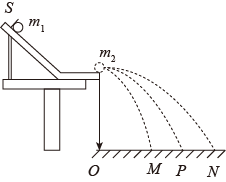

# Physics - 题目 880

**ID**: d6c8bb10189a405394fec778f2f734b8
**年级**: Grade 12
**难度**: Medium-Hard
**题型**: Experiment

## 题目
用如图所示的装置，来完成“验证动量守恒定律”的实验。​​​​​​​‌实验中使用的小球1和2半径相等，用天平测得质量分别为m_{1}、m_{2}，且m_{1 }>m_{2}。在木板上铺一张白纸，白纸上面铺放复写纸，记下重锤线所指的位置O。先不放小球2，使小球1从斜槽上某一点S由静止滚下，落到水平地面P点。再把小球2静置于斜槽轨道末端，让小球1仍从S处由静止滚下，小球1和小球2碰撞后分别落在复写纸上，在白纸上留下各自落点的痕迹。（1）实验中，直接测定小球碰撞前后的速度是不容易的，可以通过测量小球做平抛运动的射程来解决这个问题。确定碰撞前后落点的位置P、M、N，用刻度尺测量出水平射程OP、OM、ON。①本实验必须满足的条件是

## 解答

1. （1）因小球在斜槽末端的速度与平抛的水平位移成正比，所以斜槽是否光滑对该实验影响不大，A错误；斜槽末端保持水平，是为了保证它们在水平碰撞后做平抛运动，B正确；小球1每次必须从同一高度释放，保证尽可能每次碰撞情况相同，C正确。小球离开斜槽末端做平抛运动，竖直方向满足 $y=\frac {1}{2}gt{^{2}}$ ，下落高度一定，运动时间相同；水平方向满足 $x=vt$ ，水平位移与平抛初速度成正比，两球相碰前后的动量守恒，其表达式可表示为 $m{{}_{1}}{\overline{{\rm{O}}{\rm{P}}}}=m{{}_{1}}{\overline{{\rm{O}}{\rm{M}}}}+m{{}_{2}}{\overline{{\rm{O}}{\rm{N}}}}$ 。
2. （3）碰撞前的动量等于碰撞后的动量，所以P点是碰撞前的位置，M点是碰撞后的位置，N点是被碰小球的下落位置，AC错误，B正确。

## 知识点

**中文**:
  - 研究斜槽末端小球碰撞时的动量守恒

**English**:
  - Momentum Conservation in Collision at End of Inclined Ramp

---
