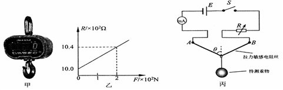

# Physics - 题目 461

**ID**: d9b4dc4871c0462d8995d9d843c785bd
**年级**: Grade 12
**难度**: Medium-Hard
**题型**: Experiment

## 题目
图甲所示是大型机械厂里用来称重的电子吊秤，其中实现称重的关键元件是拉力传感器。​​​​​​​‌其工作原理是：挂钩上挂上重物，传感器中拉力敏感电阻丝在拉力作用下发生形变，拉力敏感电阻丝的电阻也随着发生变化，再经相应的测量电路把这一电阻变化转换为电信号（电压或电流），从而完成将所称物体重量变换为电信号的过程。(1)简述拉力敏感电阻丝的阻值随拉力变化的原因。(2)小明找到一根拉力敏感电阻丝R_{L}，其阻值随拉力变化的图像如图乙所示，再按图丙所示电路制作了一个简易“吊秤”。电路中电源电动势E约15V，内阻约2Ω；灵敏毫安表量程为10mA，内阻约5Ω；R是电阻箱，最大阻值是9999Ω；R_{L}接在A、B两接线柱上，通过光滑绝缘滑环可将重物吊起，接通电路完成下列操作．a．滑环下不吊重物时，调节电阻箱，当电流表为某一合适示数I时，读出电阻箱的读数R_{1}；b．滑环下吊上待测重物，测出电阻丝与竖直方向的夹角为θ；c．调节电阻箱，使，读出此时电阻箱的读数R_{2}；d．算得图乙直线的斜率k和截距b；则待测重物的重力G的表达式为G=（用以上测得的物理量表示），测得θ=53°（sin53°=0.8，cos53°=0.6），R_{1}、R_{2}分别为1052Ω和1030Ω，结合乙图信息，可得待测重物的重力G=N（结果保留三位有效数字）。(3)针对小明的设计方案，为了提高测量重量的精度，你认为下列措施可行的是。

## 解答

1. (1)[1]电阻丝受拉力时，长度增加而横截面积减小，根据电阻定律知其阻值增大；
2. (2)[2][3][4]根据等效替代法测电阻，调节电阻箱，使电流表的示数仍为I；由其阻值随拉力变化的图像可得：
3. $k=\frac {ΔR}{ΔF}=\frac {1040-1000}{200}=0.2$
4. 由平衡条件得：
5. $2ΔF{\cos}θ=G$
6. 由等效替代法测电阻得：
7. $ΔR=R{{}_{1}}-R{{}_{2}}$
8. 联立解得：
9. $G=\frac {2\left ({R{{}_{1}}-R{{}_{2}}}\right ){\cos}θ}{k}$
10. 可得待测重物的重力
11. $G=\frac {2\times (1052-1030)\times 0.6}{0.2}{\rm{N}}=132{\rm{N}}$
12. (3)[5]为了提高测量重量的精度，将电阻箱换成精度更高的电阻箱，适当增大A、B接线柱之间的距离，根据闭合电路欧姆定理得电流
13. $I=\frac {E}{R{{}_{总}}}$
14. 只有几毫安，所以不能将毫安表换成量程为10μA的微安表，或不能将毫安表换成其他量程，故选CD。

## 知识点

**中文**:
  - 实验：导体电阻率的测量
  - 电阻应变片

**English**:
  - Experiment: Measuring Resistivity
  - Strain Gauge

---
