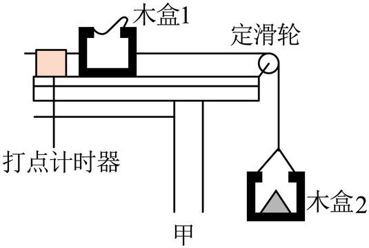
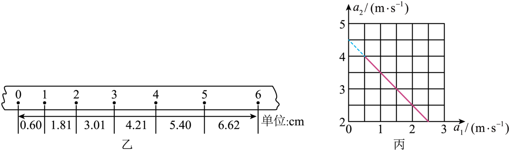

# Physics - 题目 2578

**ID**: ee958e4d1f1c4246b3a46d05700c1b7a
**年级**: Grade 12
**难度**: Medium-Hard
**题型**: Experiment

## 题目
某同学在实验室取两个完全相同的木盒，来测量木盒与木板之间的动摩擦因数。​​​​​​​‌由于实验室中的天平损坏，无法称量质量，他采用“对调法”完成测量，如图甲所示，一端装有定滑轮的长木板固定在水平桌面上，木盒1放置在长木板上，左端与穿过打点计时器的纸带相连，右端用细线跨过定滑轮与木盒2相接。（1）实验前，（填A．“需要”或B．“不需要”）调整定滑轮的角度使细线与木板平行，（填A．“需要”或B．“不需要”）将长木板左侧垫高来平衡摩擦力，如甲图所示，加速运动过程中，绳子中拉力（填A．“大于”、B．“等于”或C．“小于”）木盒2（含细沙）的总重力。（2）实验时，木盒1不放细沙，质量设为 $m{{}_{1}}$ ，在木盒2中装入适量的细沙，木盒2含沙总质量设为 $m{{}_{2}}$ ，接通电源，释放纸带，打点计时器打出一条纸带，加速度记为 $a{{}_{1}}$ ，随后将木盒1与木盒2（含细沙）位置互换，换一条纸带再次实验，打出第二条纸带，加速度记为 $a{{}_{2}}$ ，两纸带编号为第一组，改变木盒2中细沙的多少，重复上述过程，得到多组纸带。如图乙为某组实验中获得的两条纸带中的一条，其中相邻两计数点间还有4个计时点未标出，已知交流电源的频率为50Hz，则该纸带运动的加速度 $a=$m/s^{2}（保留3位有效数字）。（3）通过理论分析，分别推导 $a{{}_{1}}$ 和 $a{{}_{2}}$ 的表达式后，找到 $a{{}_{2}}$ 和 $a{{}_{1}}$ 的关系： $a{{}_{2}}=$（结果用 $a{{}_{1}}$ 、 $μ$ 和 $g$ 表示）。（4）将实验测得的加速度绘制在丙图中，得到 $a{{}_{2}}-a{{}_{1}}$ 关系图像，已知当地重力加速度为9.80m/s²，由图像可得木盒与木板间的动摩擦因数为（保留2位有效数字）。（5）由于纸带的影响，实验测得的动摩擦因数将（填A．“保持不变”、B．“偏大”或C．“偏小”）。

## 解答

1. （1）实验中，为了确保细线的拉力就沿长木板方向，需要调整定滑轮的高度，使细线与长木板平行。
2. 实验目的是测量木盒与木板之间的动摩擦因数，可知，实验中不需要将长木板左侧垫高来平衡摩擦力。
3. 甲图中，加速运动过程中，木盒2的加速度方向向下，根据牛顿第二定律可知，绳子中拉力小于木盒2（含细沙）的总重力。
4. （2）相邻两计数点间还有4个计时点未标出，则相邻计数点间的时间间隔为 $T=5\times \frac {1}{50}{\rm{s}}=0.1{\rm{s}}$
5. 根据逐差法得出加速度 $a=\frac {\left ({x{{}_{6}}+x{{}_{5}}+x{{}_{4}}}\right )-\left ({x{{}_{3}}+x{{}_{2}}+x{{}_{1}}}\right )}{{\left({3T}\right)^{2}}}=1.20{\rm{m}}/{\rm{s}}{^{2}}$
6. （3）设木盒1的质量为 $m{{}_{1}}$ ，木盒2（含细沙）的质量为 $m{{}_{2}}$ ，对整体进行分析，根据牛顿第二定律有 $m{{}_{2}}g-{\rm μm}{{}_{1}}g=\left ({m{{}_{1}}+m{{}_{2}}}\right )a{{}_{1}}$ ，位置互换后，对整体进行分析，根据牛顿第二定律有 $m{{}_{1}}g-{\rm μm}{{}_{2}}g=\left ({m{{}_{1}}+m{{}_{2}}}\right )a{{}_{2}}$ ，解得 $a{{}_{2}}=\left ({1-μ}\right )g-a{{}_{1}}$
7. （4）结合上述有 $a{{}_{2}}=\left ({1-μ}\right )g-a{{}_{1}}$ ，根据图丙有 $\left ({1-μ}\right )g=4.5{\rm{m}}{\rm{/}}{\rm{s}}{^{2}}$ ，解得 $μ\approx 0.54$
8. （5）由于纸带与打点计时器间有摩擦，所以测量的动摩擦因数会偏大。

## 知识点

**中文**:
  - 创新实验—测量动摩擦因数

**English**:
  - Measuring Coefficient of Kinetic Friction

---
