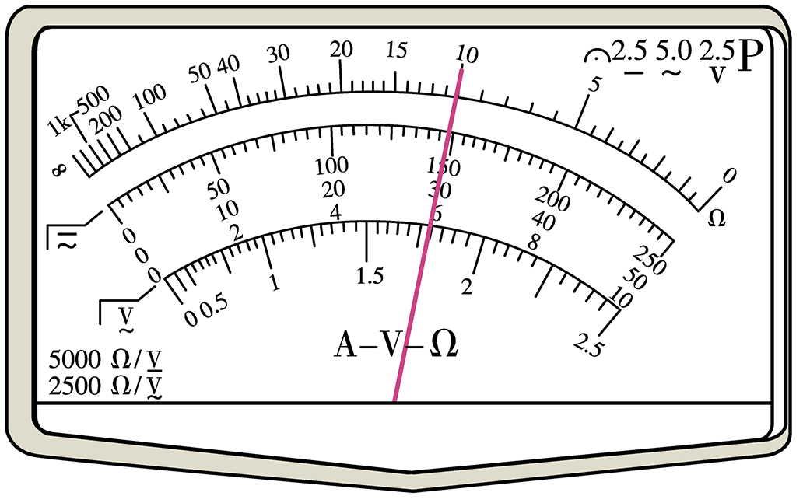

# Physics - 题目 405

**ID**: f613e73012274060807c5adfd04bb2ce
**年级**: Grade 12
**难度**: Medium-Hard
**题型**: Experiment

## 题目
某同学要测量一未知电阻 $R{{}_{x}}$ 的阻值，进行如下操作∶（1）该同学先用欧姆表“×10”倍率粗测电阻 $R{{}_{x}}$ ，结果发现欧姆表指针的偏转角度过小，为了测量结果比较准确，应将选择开关拨到（填“×1”或“×100”）倍率，再将红、黑表笔短接进行欧姆调零，再次测量电阻 $R{{}_{x}}$ ，欧姆表指针所指位置如图所示，则被测电阻 $R{{}_{x}}$ 的阻值为 ${\rm{Ω}}$ ；​​​​​​​‌（2）为精确测量电阻 $R{{}_{x}}$ 的阻值，该同学又准备了以下器材∶

## 解答

1. （1）欧姆表指针的偏转角度过小，表明通过欧姆表的电流较小，即所测电阻阻值较大，为了减小读数误差，需要使得指针指在欧姆表的中央刻线附近，则需要换用高倍率挡位，即应将选择开关拨到“×100”倍率；根据欧姆表的读数规律，该读数为 $10\times 100{\rm{Ω}}=1000{\rm{Ω}}$ 。
2. （2）①电源电动势为3V，待测电阻 ${{1}}{{0}}{{0}}{{0}}{\rm{Ω}}$ ，可知流经待测电阻的最大电流为 $I{{}_{{\rm \max }}}=\frac {3}{1000}{\rm{A}}=3mA$ ，则电流表应选择量程为0~3mA的 ${\rm{A}}{{}_{1}}$ ；
3. 为了便于调节滑动变阻器，使电表读数变化明显，滑动变阻器应选择最大阻值为 ${{1}}{{0}}{\rm{Ω}}$ 的滑动变阻器 $R{{}_{1}}$ ；
4. 实验要求电压从零开始变化，则滑动变阻器应采用分压式接法，且由于待测电阻的阻值远大于电流表的内阻，为了减小实验误差，测量电路应采用电流表内接法，该实验电路图如图所示
5. 
6. 图中电压表读数为 $1.20{\rm{V}}$
7. 电流表的示数为1.21mA，则 $R{{}_{x}}=\frac {1.20}{1.21\times 10{^{-3}}}{\rm{Ω}}\approx 991.74{\rm{Ω}}$

## 知识点

**中文**:
  - 实验：电阻的测量

**English**:
  - Experiment: Measuring Resistance

---
