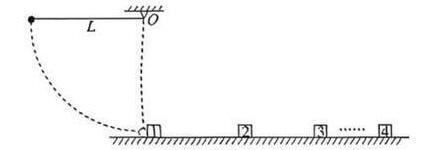

# Physics - 题目 1168

**ID**: 0f630975665a46849e23227a34f635d5
**年级**: Grade 12
**难度**: Medium-Hard
**题型**: 非选择题：本题共5小题，共56分.

## 题目
（14分）如图所示，固定点 $\mathit{O}$ 处悬挂长为 $\mathit{L}$ 的轻质细绳，细绳的末端拴接一个质量为 $\text{2}\mathit{m}$ 的小球.​​​​​​​‌光滑水平地面上有 $\mathit{n}$ 个质量均为 $\mathit{m}$ 的相同小滑块，从左向右依次编号为 $\text{1}\text{、}\text{2}\text{、}\text{⋯}\text{、}\mathit{n}$ .现将细线水平拉直，静止释放小球，当小球摆到最低点时刚好与小滑块1发生弹性碰撞.已知滑块间的每次碰撞时间极短，重力加速度大小为 $\mathit{g}$ .（1）求小球与1号小滑块碰前瞬间细绳的拉力大小；（2）若所有滑块间的碰撞是弹性碰撞，求小滑块 $\mathit{n}$ 被碰后速度大小；（3）若所有滑块间的碰撞是完全非弹性碰撞，求因碰撞损失的机械能.

## 解答

1. （1）小球下摆过程：由机械能守恒得 $\text{2}\mathit{mgL}\text{=}\frac{\text{1}}{\text{2}}\text{×2}\mathit{m}{\mathit{v}}_{\text{0}}^{\text{2}}$ （1分）
2. 碰前瞬间小球所需向心力由拉力和重力的合力提供 ${\mathit{F}}_{\mathit{T}}\text{-2}\mathit{mg}\text{=2}\mathit{m}\frac{{\mathit{v}}_{\text{0}}^{\text{2}}}{\mathit{L}}$ （1分）
3. 联立解得 ${\mathit{F}}_{\mathit{T}}\text{=6}\mathit{mg}$ （1分）
4. （2）小球与滑块1发生弹性碰撞，由动量守恒和能量守恒，得 $\text{2}\mathit{m}{\mathit{v}}_{\text{0}}\text{=2}\mathit{mv}\text{+}\mathit{m}{\mathit{v}}_{\text{1}}$ （1分）
5. $\frac{\text{1}}{\text{2}}\text{×2}\mathit{m}{\mathit{v}}_{\text{0}}^{\text{2}}\text{=}\frac{\text{1}}{\text{2}}\text{×2}\mathit{m}{\mathit{v}}^{\text{2}}\text{+}\frac{\text{1}}{\text{2}}\mathit{m}{\mathit{v}}_{\text{1}}^{\text{2}}$ （1分）
6. 联立解得 $\mathit{v}\text{=}\frac{{\mathit{v}}_{\text{0}}}{\text{3}}\text{=}\frac{\sqrt{\text{2}\mathit{gL}}}{\text{3}},{\mathit{v}}_{\text{1}}\text{=}\frac{\text{4}\sqrt{\text{2}\mathit{gL}}}{\text{3}}$
7. 滑块1、2发生弹性碰撞，由动量守恒和能量守恒，得 $\mathit{m}{\mathit{v}}_{\text{1}}\text{=}\mathit{m}{\mathit{v}}_{\text{1}}^{\prime }\text{+}\mathit{m}{\mathit{v}}_{\text{2}}$ （1分）
8. $\frac{\text{1}}{\text{2}}\mathit{m}{\mathit{v}}_{\text{1}}^{\text{2}}\text{=}\frac{\text{1}}{\text{2}}\mathit{m}{\mathit{v}}_{\text{1}}^{\text{'2}}\text{+}\frac{\text{1}}{\text{2}}\mathit{m}{\mathit{v}}_{\text{2}}^{\text{2}}$ （1分）
9. 联立解得 ${\mathit{v}}_{\text{1}}^{\prime }\text{=0},{\mathit{v}}_{\text{2}}\text{=}\frac{\text{4}\sqrt{\text{2}\mathit{gL}}}{\text{3}}$ （2分）
10. 质量相等的滑块发生弹性碰撞后，二者交换速度，可知小滑块 $\mathit{n}$ 被碰后速度大小为 ${\mathit{v}}_{\mathit{n}}\text{=}\frac{\text{4}\sqrt{\text{2}\mathit{gL}}}{\text{3}}$ （1分）
11. （3）所有滑块都发生完全非弹性碰撞，整个碰撞过程中动量守恒，有 $\mathit{m}{\mathit{v}}_{\text{1}}\text{=}\mathit{nm}{\mathit{v}}_{\mathit{n}}^{\prime }$ （1分）
12. 整个过程中损失的机械能为 $\text{Δ}\mathit{E}\text{=}\frac{\text{1}}{\text{2}}\mathit{m}{\mathit{v}}_{\text{1}}^{\text{2}}\text{-}\frac{\text{1}}{\text{2}}\mathit{nm}{\mathit{v}}_{\mathit{n}}^{\text{'2}}$ （1分）
13. 联立解得 $\text{Δ}\mathit{E}\text{=}\frac{\text{16}(\mathit{n}\text{-1})\mathit{mgL}}{\text{9}\mathit{n}}$ （2分）

## 知识点

**中文**:
  - 求解弹性碰撞问题
  - 绳球模型圆周运动中机械能守恒定律的应用
  - 求解非弹性碰撞问题

**English**:
  - Solving Elastic Collision Problems
  - String-Ball Circular Motion Models
  - Solving Inelastic Collision Problems

---
