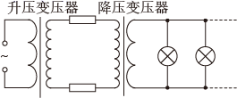

# Physics - 题目 404

**ID**: 0faed062914940a8aae6cd09e63a6942
**年级**: Grade 12
**难度**: Medium-Hard
**题型**: Multiple-choice

## 题目
一小型水电站通过升压变压器和降压变压器给某生活区供电，发电机组输出电压恒定，输电线电阻R保持不变。​​​​​​​‌该生活区夜晚用电量大于白天用电量，则夜晚与白天比较（      ）

## 解答

1. A．生活区夜晚用电量大于白天用电量，所以对应的发电机的输出功率夜晚大于白天，A错误；
2. B．夜晚输电线上电流比较大，输电线上的电压损失比较大，所以到达用户时，用户获得的电压变低，B错误；
3. C．夜晚输电线上电流比较大,根据
4. $P{{}_{损}}{\rm{=}}I{^{2}}R{{}_{线}}$
5. 输电线上损失的功率变大，C错误
6. D．夜晚输电线上电流比较大，输电线上的电压损失比较大，所以到达降压变压器时，降压变压器输入电压降低，对应的降压变压器输出电压也降低，D正确。
7. 故选D。

## 知识点

**中文**:
  - 含有理想变压器的动态电路分析
  - 电能的输送

**English**:
  - Dynamic Circuit Analysis with Ideal Transformers
  - Transmission of Electrical Energy

---
