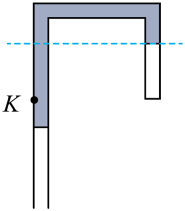

# Physics - 题目 1577

**ID**: 10b0526cd4bf496385f11a90a2072a54
**年级**: Grade 12
**难度**: Medium-Hard
**题型**: Multiple-choice

## 题目
如图，一端开口的U形管内装有水银，开口向下竖直放置时左侧水银面更低，右侧封有一段气柱压强为 $p_{气}$ ，保持温度不变，在左管K处开一小孔后（      ）​​​​​​​‌

## 解答

1. 因为在左管K处开一孔后，K处与大气相通，故K处压强为标准大气压 $p_{0}$ ，而左管下端也与大气相通，所以左管下端压强也为标准大气压 $p_{0}$ ，设K孔下方水银柱质量为m，则对K孔下方的水银柱受力分析得
2. $mg+p_{0}S>p_{0}S$
3. 所以K孔下方的水银柱将向下流出；设K孔与右侧水银面高度差为 $h^{′}$ ，则此时右管中封闭气体压强为
4. $p_{A}^{\prime }=p_{0}-h^{′}$
5. 而原来右管中封闭气体压强为
6. $p_{A}=p_{0}-h$
7. 因为
8. $h^{′}<h$
9. 所以
10. $p_{A}^{\prime }>p_{A}$
11. 即右管中封闭气体压强变大，因为温度保持不变，所以对右管中封闭气体由玻意耳定律得
12. $p_{A}^{\prime }V_{A}^{\prime }=p_{A}V_{A}$
13. 所以
14. $V_{A}^{\prime }<V_{A}$
15. 所以右管中封闭气体体积减小，故K孔上方的水银柱将上升。
16. 故选A。

## 知识点

**中文**:
  - 气体等温变化与玻意耳定律

**English**:
  - Isothermal Change and Boyle's Law

---
