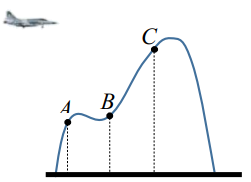

# Physics - 题目 2527

**ID**: 1a6822e45823462bbaa6efd214be6bd9
**年级**: Grade 12
**难度**: Medium-Hard
**题型**: Multiple-choice

## 题目
如图所示，一架战斗机沿水平方向匀速飞行，先后释放三颗炸弹，分别击中山坡上水平间距相等的A、B、C三点。​​​​​​​‌已知击中A、B的时间间隔为 $t_{1}$ ，击中B、C的时间间隔为 $t_{2}$ ，释放炸弹的时间间隔分别为 $Δt_{1}$ 、 $Δt_{2}$ 。不计空气阻力，则（      ）

## 解答

1. 设释放第一颗炸弹的时刻为 $t_{01}$ ，击中山坡上A点的时刻为 $t_{A}$ ，释放第二颗炸弹的时刻为 $t_{02}$ ，击中山坡上B点的时刻为 $t_{B}$ ，释放第三颗炸弹的时刻为 $t_{03}$ ，击中山坡上C点的时刻为 $t_{C}$ ，由于炸弹在空中下落过程，战斗机一直处于炸弹的正上方，则有
2. $x_{AB}=v_{0}(t_{B}-t_{A})=v_{0}t_{1}$
3. $x_{BC}=v_{0}(t_{C}-t_{B})=v_{0}t_{2}$
4. 由于
5. $x_{AB}=x_{BC}$
6. 可得
7. $t_{1}=t_{2}$
8. 设三颗炸弹在空中下落的高度分别为 $h_{A}$ 、 $h_{B}$ 、 $h_{C}$ ；则三颗炸弹在空中的下落时间分别为
9. $Δt_{A}=\sqrt {\frac {2h_{A}}{g}}=t_{A}-t_{01}$
10. $Δt_{B}=\sqrt {\frac {2h_{B}}{g}}=t_{B}-t_{02}$
11. $Δt_{C}=\sqrt {\frac {2h_{C}}{g}}=t_{C}-t_{03}$
12. 则有
13. $Δt_{1}=t_{02}-t_{01}=(t_{B}-\sqrt {\frac {2h_{B}}{g}})-(t_{A}-\sqrt {\frac {2h_{A}}{g}})=t_{1}-(\sqrt {\frac {2h_{B}}{g}}-\sqrt {\frac {2h_{A}}{g}})$
14. $Δt_{2}=t_{03}-t_{02}=(t_{C}-\sqrt {\frac {2h_{C}}{g}})-(t_{B}-\sqrt {\frac {2h_{B}}{g}})=t_{2}-(\sqrt {\frac {2h_{C}}{g}}-\sqrt {\frac {2h_{B}}{g}})$
15. 由图可知下落高度关系为： $h_{B}$ 略小于 $h_{A}$ ， $h_{C}$ 比 $h_{B}$ 小得多；则有
16. $Δt_{1}<Δt_{2}$
17. 故选B。

## 知识点

**中文**:
  - 求解平抛运动、类平抛运动问题

**English**:
  - Solving Horizontal and Quasi-Horizontal Projectile Problems

---
