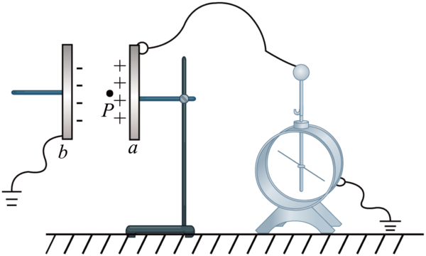

# Physics - 题目 1905

**ID**: 217149b890f1490bb144fb45990947f0
**年级**: Grade 12
**难度**: Medium-Hard
**题型**: Multiple-choice

## 题目
李明重新做教材中探究平行板电容器的电容与哪些因素有关的实验，电容器的 $a$ 、 $b$ 两极板带有等量异种电荷且不变， $a$ 板与静电计连接， $b$ 板接地。​​​​​​​‌如图所示，两板间 $P$ 点处固定一负电荷。下列说法中正确的是（      ）

## 解答

1. 将 $b$ 板上移，两极板正对面积 $\mathrm{S}$ 减小，由 $C=\frac {ε{{}_{{\rm{r}}}}S}{4πkd}$ 可知，电容减小，由 $C=\frac {Q}{U}$ 可知， $U$ 增大，静电计指针偏转角增大，A正确；将 $b$ 板左移，两极板间的距离 $d$ 增大，由 $C=\frac {ε{{}_{{\rm{r}}}}S}{4πkd}$ 可知，电容减小，由 $C=\frac {Q}{U}$ 可知， $U$ 增大，静电计指针偏转角增大；根据 $E=\frac {U}{d}$ ， $C=\frac {Q}{U}$ ， $C=\frac {ε{{}_{{\rm{r}}}}S}{4πkd}$ ，联立得 $E=\frac {4πkQ}{ε{{}_{{\rm{r}}}}S}$ ，所以两极板间的场强 $E$ 不变，由于 $P$ 点到b板的距离 $d^{′}$ 增大， $U{{}_{Pb}}=Ed^{′}$ ，所以 $P$ 点与b板间的电势差增大，而b板接地电势为零，所以 $P$ 点电势升高，由于 $P$ 点处的电荷带负电，根据 $E{{}_{{\rm{p}}}}=qφ$ 可知， $P$ 处电荷的电势能减小，BC错误；在电容器两极板间插入玻璃板的过程中，相对介电常数 $ε{{}_{{\rm{r}}}}$ 增大，由 $C=\frac {ε{{}_{{\rm{r}}}}S}{4πkd}$ 可知，电容增大，由 $C=\frac {Q}{U}$ 可知， $U$ 减小，由 $E=\frac {U}{d}$ 可知， $E$ 减小，由 $U{{}_{Pb}}=Ed^{′}$ ，所以 $P$ 点与b板间的电势差减小，而b板接地电势为零，所以 $P$ 点电势降低，由于 $P$ 点处的电荷带负电，根据 $E{{}_{{\rm{p}}}}=qφ$ 可知， $P$ 处电荷的电势能增大，D错误。

## 知识点

**中文**:
  - 平行板电容器电容大小及其影响因素

**English**:
  - Factors Affecting Capacitance of Parallel Plate Capacitors

---
