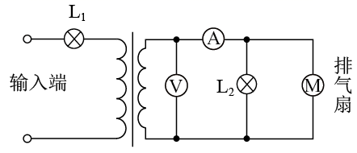

# Physics - 题目 1282

**ID**: 2443d1fe12904f2aa6ff0e653a393586
**年级**: Grade 12
**难度**: Medium-Hard
**题型**: Multiple-choice

## 题目
一交流电源电压 $u=220\sqrt {2}{\sin}100πt({\rm{V}})$ ，通过理想变压器对下图电路供电，已知原、副线圈匝数比为 $10:1$ ， $L{{}_{1}}$ 灯泡的额定功率为 $4{\rm{W}}$ ， $L{{}_{2}}$ 灯泡的额定功率为 $20{\rm{W}}$ ，排气扇电动机线圈的电阻为 $1{\rm{Ω}}$ ，电流表的示数为 $2{\rm{A}}$ ，用电器均正常工作，电表均为理想电表，则（      ）​​​​​​​‌

## 解答

1. A．由于电流表的示数I_{2}= $2{\rm{A}}$ ，由 $\frac {I{{}_{1}}}{I{{}_{2}}}=\frac {n{{}_{2}}}{n{{}_{1}}}$ 可得变压器原线圈的电流I_{1}= $0.2{\rm{A}}$ ，即流过 $L{{}_{1}}$ 的电流为 $0.2{\rm{A}}$ ，A错误；
2. BD．交流电源电压有效值为220V， $L{{}_{1}}$ 两端的电压
3. $U{{}_{L{{}_{1}}}}=\frac {P{{}_{L{{}_{1}}}}}{I{{}_{1}}}=\frac {4}{0.2}{\rm{V}}{\rm{=}}{\rm{2}}{\rm{0}}{\rm{V}}$
4. 故原线圈两端的电压 $U{{}_{1}}=200{\rm{V}}$ ，由 $\frac {U{{}_{1}}}{U{{}_{2}}}=\frac {n{{}_{1}}}{n{{}_{2}}}$ 可得变压器副线圈两端的电压 $U{{}_{2}}=20{\rm{V}}$ ，流过灯泡 $L{{}_{2}}$ 的电流
5. $I{{}_{L{{}_{2}}}}=\frac {P{{}_{L{{}_{2}}}}}{U{{}_{2}}}=\frac {20}{20}{\rm{A}}{\rm{=}}{\rm{1}}{\rm{A}}$
6. 则流过排气扇的电流
7. $I{{}_{M}}=I{{}_{2}}-I{{}_{L{{}_{2}}}}=1{\rm{A}}$
8. 排气扇电动机的发热功率为
9. $P{{}_{热}}{\rm{=}}I{{}_{M}^{2}}r=1{^{2}}\times 1{\rm{W}}=1{\rm{W}}$
10. 排气扇的电功率为
11. $P{{}_{电}}{\rm{=}}U{{}_{2}}I{{}_{M}}=20{\rm{W}}$
12. 则排气扇电动机的输出功率为
13. $P{{}_{出}}{\rm{=}}P{{}_{电}}-P{{}_{热}}{\rm{=}}19{\rm{W}}$
14. BD错误；
15. C．整个电路消耗的功率为
16. $P{{}_{总}}{\rm{=}}P{{}_{L{{}_{1}}}}+P{{}_{L{{}_{2}}}}+P{{}_{电}}{\rm{=}}{\rm{4}}{\rm{W}}{\rm{+}}{\rm{2}}{\rm{0}}{\rm{W}}{\rm{+}}{\rm{2}}{\rm{0}}{\rm{W}}=44{\rm{W}}{\rm{\;}}$
17. C正确。
18. 故选C。

## 知识点

**中文**:
  - 理想变压器原、副线圈两端的电压、功率、电流关系及其应用
  - 非纯电阻电路的相关计算

**English**:
  - Voltage, Power, Current Relations in Ideal Transformers
  - Calculations for Non-Pure Resistive Circuits

---
