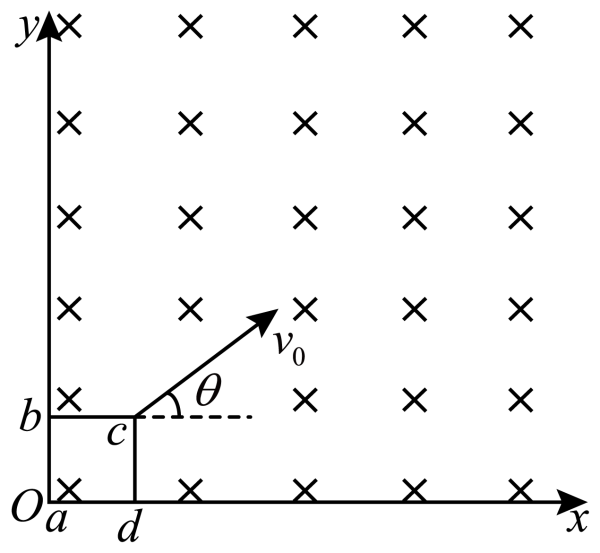

# Physics - 题目 675

**ID**: 2a60062963d4475fb28c5b3599a7fec6
**年级**: Grade 12
**难度**: Medium-Hard
**题型**: 非选择题

## 题目
如图所示，在竖直平面内有一直角坐标系xOy，第一象限存在垂直平面向里的磁场区域，磁感应强度沿y轴正方向不变，沿x轴正方向按照 $B=kx$ （ $k>0$ 为已知常数）的规律变化。​​​​​​​‌一个质量为m、边长为L且位于第一象限内的正方形导线框abcd电阻为R，初始时ad边与x轴重合，ab边与y轴重合，a点位于坐标原点O处。将导线框以速度v_{0}沿与x轴正方向成 $θ=37{}^\circ $ 抛出，一段时间后导线框速度恰好减为0，整个运动过程中导线框的两邻边始终分别平行于两坐标轴。 ${\sin}37{}^\circ =0.6$ ， ${\cos}37{}^\circ =0.8$ 。求：（1）从导线框开始运动到速度恰好减为零的过程中，线框中产生的焦耳热；（2）若导线框在 $t$ 时刻的水平分速度大小为v，此时导线框受到安培力的大小。

## 解答

1. （1）导线框 $ad$ 边与 $bc$ 边框受到的安培力大小相等，方向相反，可知导线框在竖直方向做竖直上抛运动，当导线框速度减为零时，其竖直方向上升的高度
2. $y=\frac {{\left({v{{}_{0}}{\sin}θ}\right)^{2}}}{2g}$
3. 根据能量守恒，线框中产生的焦耳热
4. $Q=\frac {1}{2}mv{{}_{0}^{2}}-mgy$
5. 联立解得
6. $Q=\frac {8}{25}mv{{}_{0}^{2}}$
7. （2）导线框在 $t$ 时刻的水平分速度大小为v，水平位移为x，则在此时刻导线框产生感应电动势大小为
8. $e=B{{}_{右}}Lv-B{{}_{左}}Lv=k(x+L)Lv-kxLv=kL{^{2}}v$
9. 导线框内的感应电流大小为
10. $I=\frac {e}{R}$
11. 所以导线框受到安培力的大小为
12. $F=B{{}_{右}}IL-B{{}_{左}}IL$
13. 联立解得
14. $F=\frac {k{^{2}}L{^{4}}v}{R}$

## 知识点

**中文**:
  - 安培力的大小
  - 电磁感应现象中的功能问题

**English**:
  - Magnitude of Ampere Force
  - Work-Energy Problems in EM Induction

---
