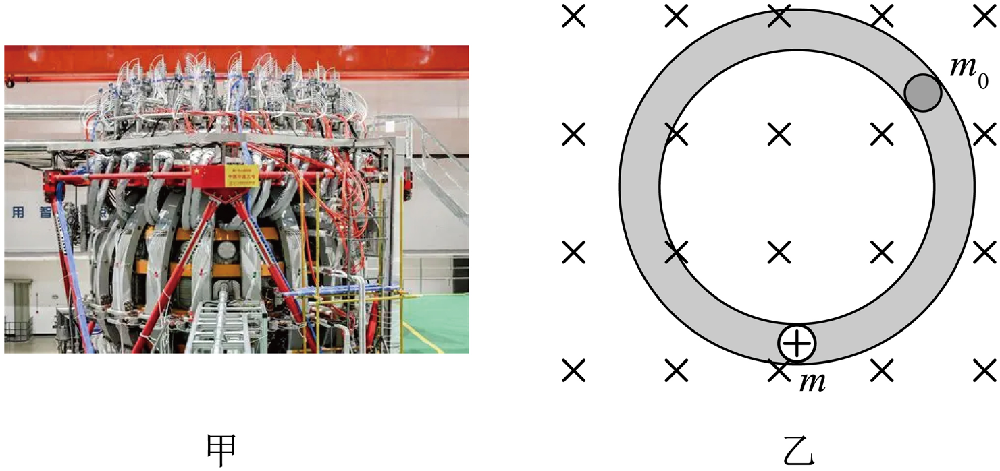

# Physics - 题目 2823

**ID**: 2cb45c04c86e46bb9ffbc73b11881fc9
**年级**: Grade 12
**难度**: Medium-Hard
**题型**: Multiple-choice

## 题目
2025年，中国环流三号（HL-3）实现更高参数的稳态运行，等离子体温度突破1.5亿摄氏度，并成功延长高约束模式（H-mode）的持续时间，向未来聚变电站工程化迈出关键一步。​​​​​​​‌可控核聚变的磁约束像一个无形的管道，将高温等离子体束缚在其中，通过电磁感应产生的涡旋电场给等离子体加速，使其达到核聚变的点火温度。可以做一些简化后的模拟计算：半径为 $r$ 的环形光滑管道处于垂直纸面向里、随时间均匀增大的匀强磁场中，磁感应强度的变化规律为 $B=kt$ ，其中 $k$ 为常数且 $k>0$ ，如图乙所示。 $t=0$ 时刻，一个质量为 $m$ 、电荷量为 $+q$ 的微粒，从静止开始被涡旋电场加速， $t$ 时刻与一个静止的中性粒子 $m{{}_{0}}$ 相撞，并结合在一起，电荷量不变。在计算过程中均不考虑重力。以下正确的是（      ）

## 解答

1. 磁感应强度满足 $B=kt$ ，则 $\frac {ΔB}{Δt}$ 恒定不变，则感应电动势恒定不变，磁场在管道内产生涡旋电场的强弱不变，A错误；根据楞次定律可知，感生电场的方向沿逆时针方向，微粒带正电，所受电场力方向与感生电场方向一样，微粒被涡旋电场加速后在磁场中的旋转方向为逆时针方向，B错误；由法拉第电磁感应定律可得环内感应电动势 $ε=n\frac {ΔΦ}{Δt}=πr{^{2}}k$ ，环内电场强度 $E=\frac {ε}{2πr}=\frac {kr}{2}$ ，粒子加速度 $a=\frac {Eq}{m}=\frac {krq}{2m}$ ，碰前粒子速度 $v=at$ ，可得 $v=\frac {krqt}{2m}{\rm ，C}$ 正确；碰撞过程动量守恒 $mv=(m+m{{}_{0}})v{^{\prime }}$ ，结合体受洛伦兹力 $f{{}_{{\rm{L}}}}=qv^{′}B=\frac {qmktv}{m+m{{}_{0}}}$ ，方向指向圆心；假设碰后瞬间管道对结合体的作用力F_{N}方向均沿圆环半径方向向外，结合体所需向心力 $f{{}_{{\rm{L}}}}-F{{}_{{\rm{N}}}}=\left ({m+m{{}_{0}}}\right )\frac {v{^{^{′}2}}}{r}$ ，将动量守恒方程以及v带入可知 $F{{}_{{\rm{N}}}}=\frac {mvkqt}{2\left ({m+m{{}_{0}}}\right )}$ ，可见无论m_{0}多大，结合体所受作用力F_{N}一定大于0，说明假设正确，所以碰后瞬间管道对结合体的作用力方向均沿圆环半径向外，结合体才能做圆周运动，D错误。

## 知识点

**中文**:
  - 楞次定律及其应用
  - 电磁感应定律的应用
  - 求解弹性碰撞问题

**English**:
  - Lenz's Law and Applications
  - Applications of Faraday's Law
  - Solving Elastic Collision Problems

---
