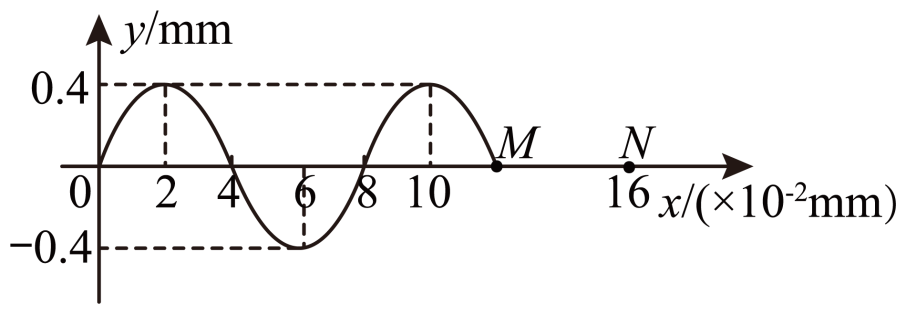

# Physics - 题目 2926

**ID**: 2d22d9480dbe46ac87a6929d2628e37e
**年级**: Grade 12
**难度**: Medium-Hard
**题型**: Multiple-choice

## 题目
B超是医院诊断科室里常见的检查方式。​​​​​​​‌其成像的基本原理是探头向人体发射一组超声波，人体组织对超声波产生反射，反射的超声波信号形成B超图像。如图为血管探头沿x轴正方向发送的简谐超声波图像，超声波在血管中的传播速度为 $1.6\times 10{^{3}}{\rm{m}}{\rm{/}}{\rm{s}}{\rm ，\mathit{t}=0}$ 时刻波恰好传到M点，下列说法正确的是（      ）

## 解答

1. 该超声波的周期为 $T=\frac {λ}{v}=\frac {8\times 10{^{-2}}\times 10{^{-3}}}{1.6\times 10{^{3}}}{\rm{s}}=5\times 10{^{-8}}{\rm{s}}$ ，选项A错误；因为 $1.25\times 10{^{-7}}{\rm{s}}{\rm{=}}2\frac {1}{2}{\rm{T}}$ ，则 $0\sim 1.25\times 10{^{-7}}{\rm{s}}$ 内M点运动的路程为10A=4mm，选项B错误；再经过 $\frac {3T}{4}=\frac {15}{4}\times 10{^{-8}}{\rm{s}}$ ，波向右传播 $\frac {3λ}{4}$ ，此时M点第一次位移为-0.4mm，选项C错误；当N点第二次处于波峰时，波向右传播 ${\rm 14m=}14{\rm{m}}=\frac {7λ}{4}$ ，此时对应的时刻为 $t=\frac {7}{4}T=\frac {35}{4}\times 10{^{-8}}{\rm{s}}$ ，选项D正确。

## 知识点

**中文**:
  - 振幅、周期、频率、相位和波长及其计算
  - 简谐运动的函数与图像

**English**:
  - Calculation of Amplitude, Period, Frequency, Phase, and Wavelength
  - Functions and Graphs of SHM

---
