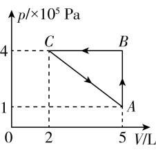

# Physics - 题目 537

**ID**: 2f6125c2f3194abb8684b9d8ec09a96d
**年级**: Grade 12
**难度**: Medium-Hard
**题型**: Multiple-choice

## 题目
一定质量的理想气体从状态 $A$ 开始，经 $A\to B$ 、 $B\to C$ 、 $C\to A$ 三个过程后回到初始状态 $A$ ，其 $p-V$ 图像如图所示，已知状态 $A$ 的气体温度为 ${T}_{A}=200\mathrm{K}$ ，下列说法正确的是（      ）​​​​​​​‌

## 解答

1. 在 $A\to B$ 过程中，气体发生等容变化，根据查理定律得 $\frac{{p}_{A}}{{T}_{A}}=\frac{{p}_{B}}{{T}_{B}}$ ，解得 ${T}_{B}=800\mathrm{K}$ ， $\mathrm{A}$ 正确；在 $A\to B$ 过程中，气体的体积不变，所以气体对外不做功， $\mathrm{B}$ 错误；在 $B\to C$ 过程中，气体的压强不变，体积减小，外界对气体做功为 ${W}_{1}={p}_{B}({V}_{B}-{V}_{C})=4×{10}^{5}×(5-2)×{10}^{-3}\mathrm{J}=1200\mathrm{J}$ ， $\mathrm{C}$ 错误；在 $A\to B\to C\to A$ 一个循环过程中，内能不变，则 $\mathrm{\Delta }U=0$ ； $ABC$ 围成的面积表示一个循环过程中外界对气体做的功，为 $W=\frac{1}{2}×(5-2)×{10}^{-3}×(4-1)×{10}^{5}\mathrm{J}=450\mathrm{J}$ ，根据热力学第一定律 $\mathrm{\Delta }U=W+Q$ ，可知，气体从外界吸收的热量 $Q=\mathrm{\Delta }U-W=-450\mathrm{J}$ ，即气体向外界释放热量 $450\mathrm{J}$ ， $\mathrm{D}$ 错误．

## 知识点

**中文**:
  - 气体的p-V图像问题
  - 热力学第一定律及其应用

**English**:
  - p-V Graph Problems
  - First Law of Thermodynamics and Applications

---
