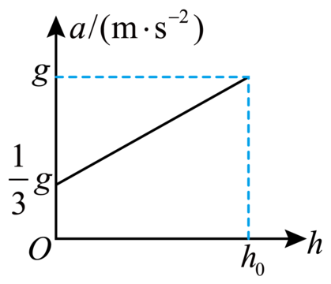

# Physics - 题目 1978

**ID**: 39b81eb2cd88480aaeade97ccc070bba
**年级**: Grade 12
**难度**: Medium-Hard
**题型**: Multiple-choice

## 题目
一航空兴趣小组自制一带动力飞行器。​​​​​​​‌小组开始让飞行器悬停在空中，某次测得从高处竖直向下运动h_{0}范围内，飞行器的加速度a与下降的高度h关系如图所示。设飞行器总质量为m不变，取向下方向为正方向，重力加速度为g。飞行器下落过程中，忽略空气阻力。下列说法正确的是（      ）

## 解答

1. A．由图像可得图线斜率为
2. $k=\frac {g-\frac {g}{3}}{h{{}_{0}}}=\frac {2g}{3h{{}_{0}}}$
3. 则飞行器的加速度a与下降的高度h关系式
4. $a=\frac {1}{3}g+\frac {2g}{3h{{}_{0}}}h$
5. 当飞行器下降 $\frac {1}{2}h{{}_{0}}$ 时，可得加速度为
6. $a=\frac {2}{3}g$
7. 则
8. $mg-F=ma$
9. 求解得
10. $F=\frac {1}{3}mg$
11. 故A错误；
12. B．飞行器下降 $\frac {1}{2}h{{}_{0}}$ 过程中，其动能变化对应合外力做功，纵坐标乘质量为合力大小，其大小为解析图的梯形面积大小乘质量m，由动能定理
13. $mg\cdot \frac {1}{2}h{{}_{0}}+W=\frac {1}{4}mgh{{}_{0}}$
14. 可得
15. $W=-\frac {1}{4}mgh{{}_{0}}$
16. 故发动机做负功，所以其机械能减小 $\frac {1}{4}mgh{{}_{0}}$ ，故B错误；
17. CD．飞行器下降h_{0}时有
18. $W{{}_{合}}=m\cdot \frac {\frac {g}{3}+g}{2}\cdot h{{}_{0}}=\frac {1}{2}mv{^{2}}$
19. 可得速度大小为
20. $v=\sqrt {\frac {4}{3}gh{{}_{0}}}$
21. 且此时飞行器只受重力，则发动机提供的动力为0，功率为0，故C正确，D错误。
22. 故选C。

## 知识点

**中文**:
  - 动能定理的简单应用

**English**:
  - Simple Applications of Work-Energy Theorem

---
