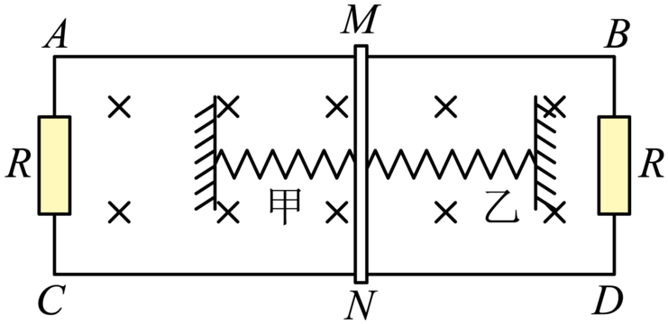

# Physics - 题目 1556

**ID**: 3bf17718133f4cf9a9b9eb5c8c6ec337
**年级**: Grade 12
**难度**: Medium-Hard
**题型**: Multiple-choice

## 题目
如图所示， $AB、CD$ 为两个平行的水平光滑金属导轨，处在方向竖直向下、磁感应强度为B的匀强磁场中， $AB、CD$ 的间距为L，左、右两端均接有阻值为R的电阻。​​​​​​​‌质量为m、长为L，且不计电阻的导体棒 $MN$ 放在导轨上，甲、乙为两根相同的轻质弹簧，弹簧一端与 $MN$ 棒中点连接，另一端均被固定。导体棒 $MN$ 与导轨接触良好。开始时，弹簧处于自然长度，导体棒 $MN$ 具有水平向左的初速度 $v{{}_{0}}$ ，经过一段时间，导体棒 $MN$ 第一次运动到最右端，这一过程中，整个回路产生的焦耳热为Q，则（      ）

## 解答

1. 感应电动势 $E=BLv{{}_{0}}$ ，感应电流 $I=\frac {E}{R{{}_{并}}}=\frac {BLv{{}_{0}}}{\frac {R}{2}}=\frac {2BLv{{}_{0}}}{R}$ ，导体棒受到的安培力 $F{{}_{{\rm{A}}}}=BIL=\frac {2B{^{2}}L{^{2}}v{{}_{0}}}{R}{\rm ，A}$ 错误；由于回路中产生焦耳热，棒和弹簧的机械能有损失，所以棒再次回到初始位置时，速度小于 $v{{}_{0}}$ ，棒产生的感应电动势 $E<BLv{{}_{0}}$ ，电功率公式 $P=\frac {E{^{2}}}{R}$ ，知，AC间电阻R的功率小于 $\frac {B{^{2}}L{^{2}}v{{}_{0}}{^{2}}}{R}{\rm ，B}$ 错误。MN棒第一次运动至最右端的过程中，整个回路产生的焦耳热为Q，由能量守恒定律得 $\frac {1}{2}mv{{}_{0}^{2}}=Q+2E{{}_{{\rm{p}}}}$ ，此时弹簧的弹性势能 $E{{}_{{\rm{p}}}}{\rm{=}}\frac {1}{4}mv{{}_{0}^{2}}-\frac {Q}{2}{\rm ，C}$ 正确；当导体棒第一次到达最右端时，整个回路产生的焦耳热为 $Q$ ，整个运动过程中，安培力一直做负功，导体棒第一次到达最左端的过程中，导体棒的平均速度最大，受到的平均安培力最大，位移最大，安培力做功最大，则回路中产生的焦耳热 $Q{^{^{′}}}>\frac {1}{3}\cdot Q=\frac {1}{3}Q$ ，无法判断是否大于 $\frac {2}{3}Q{\rm ，D}$ 错误。

## 知识点

**中文**:
  - 单杆模型
  - 导体切割磁感线产生感应电动势（电流）的分析与计算
  - 电磁感应现象中的功能问题

**English**:
  - Single Rod Model
  - Analysis and Calculation of Cutting Magnetic Field Lines
  - Work-Energy Problems in EM Induction

---
