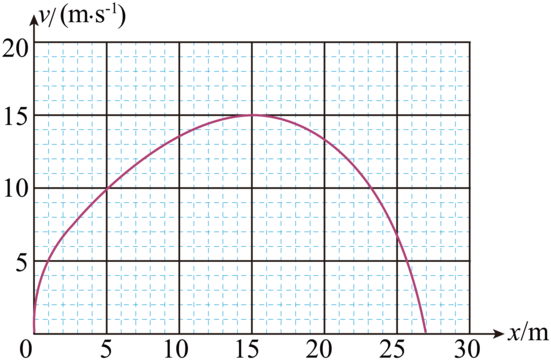

# Physics - 题目 1789

**ID**: 418bd0c9e9fd4730830d73c5430aabcb
**年级**: Grade 12
**难度**: Medium-Hard
**题型**: Multiple-choice

## 题目
研究蹦极运动时，在运动员身上装好传感器，用于测量他在不同时刻下落的高度及速度。​​​​​​​‌运动员身系弹性绳，从蹦极台无初速度下落，根据某次传感器测到的数据，得到如图所示的速度—位移图像。忽略空气阻力，根据图像可知（      ）

## 解答

1. A．由图像可知位移大小为15m时，速度大小为最大值，可知该位移处有弹性绳的弹力与运动员的重力等大，所以弹性绳处于伸长状态，即弹性绳的原长小于15m，故A错误；
2. B．运动员下落过程中先做加速度为g的加速运动，至弹性绳恰好拉直后运动员继续做加速度减小的加速运动，直至速度达到最大，此时位移大小为15m，所以0~15m下落过程中，运动员重力势能的减少量等于动能的增加量加上弹性绳弹性势能的增加量，故B正确；
3. C．15m时，弹性绳的弹力与运动员的重力等大合力为零，之后运动员继续向下运动，弹性绳伸长量继续变大，弹性绳弹力大于重力，合力向上且变大。故C错误；
4. D．0~27m下落过程中由动量定理可得
5. $I{{}_{G}}+I{{}_{弹}}=0$
6. 可知运动员重力冲量大小等于弹性绳弹力冲量大小，故D错误。
7. 故选B。

## 知识点

**中文**:
  - 非常规图像问题

**English**:
  - Non-standard Graph Problems

---
