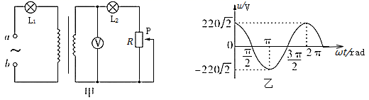

# Physics - 题目 398

**ID**: 45d304ad8662483f8c0b14f3b355e09d
**年级**: Grade 12
**难度**: Medium-Hard
**题型**: Multiple-choice

## 题目
如图甲所示，理想变压器原、副线圈匝数比为3：1，理想电压表读数为55V，灯泡L_{1}的功率为55W，a、b端输入稳定的交变电压如图乙所示，滑动变阻器最大电阻为20Ω，滑片P处于电阻R的中间位置，则（      ）​​​​​​​‌

## 解答

1. AB．理想电压表读数为55V，根据电压比可知变压器原线圈两端电压为165V，ab端输入电压有效值为220V，则灯泡L_{1}电压为55V，流过灯泡L_{1}的电流为1A，根据电流比可知变压器输出电流为3A，滑动变阻器的电压为30V，则灯泡L_{2}电压为25V，功率P_{2}=25×3=75W，则L_{1}与L_{2}消耗的电功率之比为11：15，A选项正确，B选项错误。
2. CD．若向上移P，负载电阻变小，变压器输出电流变大，变压器输入电流变大，输入功率变大，灯泡L_{1}电压变大，原线圈两端电压变小，次级电压也减小，电压表读数将变小，则选项CD选项错误。
3. 故选A。

## 知识点

**中文**:
  - 含有理想变压器的动态电路分析
  - 理想变压器原、副线圈两端的电压、功率、电流关系及其应用

**English**:
  - Dynamic Circuit Analysis with Ideal Transformers
  - Voltage, Power, Current Relations in Ideal Transformers

---
