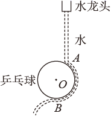

# Physics - 题目 2594

**ID**: 467d9ae59c7548829cf0a8a6faa6caff
**年级**: Grade 12
**难度**: Medium-Hard
**题型**: Multiple-choice

## 题目
打开水龙头，调节流速，流出涓涓细流，如图所示。​​​​​​​‌若将乒乓球靠近竖直的水流时，水流受到乒乓球指向球心方向的“吸附力”作用会被吸引，顺着乒乓球表面流动。这个现象称为康达效应。如图所示，某同学在实验时，水流从A点顺着半径为R的乒乓球表面流动，O为乒乓球的球心(球心与A、水龙头位干同一将直平而内)，调节乒乓球(A与水龙头之间的距离，使水流恰好在乒乓球的最低点B与之分离，最后落在水平地面上的C点(未画出)。已知B点到C点的水平射程为x，B点距地面的高度为h，不计一切阻力，重力加速度为g。下列说法正确的是（      ）

## 解答

1. A．水流沿着乒乓球表面做加速圆周运动，故A错误；
2. B．设水到B点的速度为 $v$ ，水流离开B点之前的瞬间，其向心加速度大小为
3. $a{{}_{n}}=\frac {v{^{2}}}{R}$
4. 根据平抛运动的规律有
5. $h=\frac {1}{2}gt{^{2}}$
6. $x=vt$
7. 联立得向心加速度
8. $a{{}_{n}}=\frac {x{^{2}}}{2hR}\cdot g$
9. 故B错误；
10. C．水流受到乒乓球的“吸附力”属于电磁相互作用，故C错误；
11. D．在B点质量为 $Δm(Δm\to 0)$ 的水向心加速度为
12. $a{{}_{n}}=\frac {x{^{2}}}{2hR}\cdot g$
13. 根据牛顿第二定律有
14. $F-\Delta mg=ma{{}_{n}}$
15. 联立解得
16. $\frac {F}{Δm}=\left ({1+\frac {x{^{2}}}{2hR}}\right )g$
17. 故D正确。
18. 故选D。

## 知识点

**中文**:
  - 向心加速度的计算
  - 平抛运动与斜面、圆轨道相结合问题

**English**:
  - Calculation of Centripetal Acceleration
  - Horizontal Projectile on Inclined Planes and Circular Tracks

---
