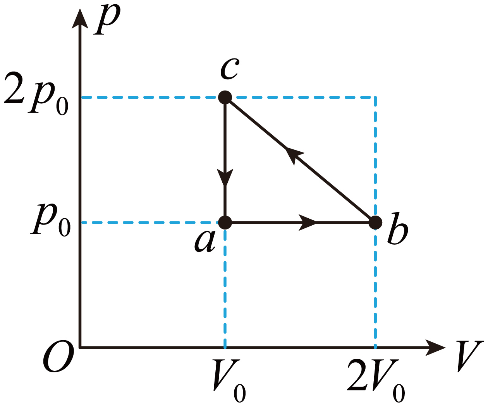

# Physics - 题目 2867

**ID**: 4b65971149054b378c351ce200c91076
**年级**: Grade 12
**难度**: Medium-Hard
**题型**: Multiple-choice

## 题目
一定质量的理想气体，从状态 $a$ 开始经历如图所示的状态变化过程回到原状态，则下列说法中正确的是（      ）​​​​​​​‌

## 解答

1. 由理想气体状态方程 $\frac {pV}{T}=C$ 及图像可知， $a\to b$ 的过程，气体压强不变，体积增大，所以气体的温度增加，则内能增加，即 $ΔU>0$ ；同时气体对外做功，即 $W<0$ ；所以由热力学第一定律 $ΔU=W+Q$ ，可得 $Q=ΔU-W>0$ ，即 $a\to b$ 的过程气体吸收热量，A错误；由图像可知状态 $b$ 时气体的压强为 $p{{}_{0}}$ ，体积为 $2V{{}_{0}}$ ；状态 $c$ 时气体的压强为 $2p{{}_{0}}$ ，体积为 $V{{}_{0}}$ ，设状态 $b$ 和状态 $c$ 时气体的温度分别为 $T{{}_{b}}$ 和 $T{{}_{c}}$ ，根据理想气体状态方程有 $\frac {p{{}_{0}}\cdot 2V{{}_{0}}}{T{{}_{b}}}=\frac {2p{{}_{0}}V{{}_{0}}}{T{{}_{c}}}$ ，解得 $T{{}_{b}}=T{{}_{c}}$ ，但是 $b\to c$ 是直线过程， $pV$ 乘积先增大后减小，所以温度也是先增大后减小。由于温度是分子平均动能的标志，所以此过程中平均动能先增大后减小，B错误；b、c状态温度相同，分子平均动能相同，c状态压强比b状态大，根据压强的微观解释可知，压强等于单位时间内撞击容器壁单位面积的分子数与分子平均冲力的乘积，由于分子平均动能相同则分子平均冲力相同，所以c状态比b状态单位时间内撞击容器壁单位面积的分子数多，C正确；一次循环过程中，由 $p-V$ 图线与坐标轴围成的面积可知外界对气体做功，即 $W>0$ ；而由于又回到原状态，温度不变，所以内能不变，即 $ΔU=0$ 。根据热力学第一定律 $ΔU=W+Q$ ，可得 $Q=\Delta U-W<0$ ，即气体吸收的热量小于放出的热量，D错误。

## 知识点

**中文**:
  - 气体压强的微观解释
  - 热力学第一定律与理想气体状态方程的综合应用

**English**:
  - Microscopic Explanation of Gas Pressure
  - Integrated Application of 1st Law and Ideal Gas Law

---
