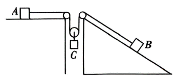

# Physics - 题目 308

**ID**: 4e9904245b5c4c949a3129df0b2f6054
**年级**: Grade 12
**难度**: Medium-Hard
**题型**: Multiple-choice

## 题目
如图所示，A、B两滑块的质量均为m，用一轻绳将两滑块相连后，将A置于固定的光滑水平面上，将B置于固定的光滑斜面上，斜面的倾角为30°，并将A、B稳住不动。​​​​​​​‌将一轻质动滑轮置于轻绳上，再将质量为2m的钩码C挂于动滑轮上。现先后按以下两种方式操作：第一次将B稳住，由静止释放A；第二次将A稳住，由静止释放B。物体C下落相同位移x时（C下落过程中，A、B均没有与定滑轮碰撞），设两次下落的时间分别为t_{1}、t_{2}，物体C的加速度分别为a_{1}、a_{2}，物体C的动能分别为E_{k1}、E_{k2}，由A、B、C组成的系统减少的重力势能分别为∆E_{p1}、∆E_{p2}。滑轮摩擦不计，则下列说法不正确的是（      ）

## 解答

1. 第一次固定B，物体C下落过程中，设轻绳的拉力为F_{1}，对物体A有 $F{{}_{1}}=ma{{}_{{\rm{A}}}}$ ， $2x=\frac {1}{2}a{{}_{{\rm{A}}}}t{{}_{1}^{2}}$ ，对物体C有 $2mg-2F{{}_{1}}=2ma{{}_{1}}$ ， $x=\frac {1}{2}a{{}_{1}}t{{}_{1}^{2}}$ ，可得 $\frac {1}{2}a{{}_{{\rm{A}}}}=a{{}_{1}}=\frac {1}{3}g$ ， $t{{}_{1}}=\sqrt {\frac {6x}{g}}$ ，物体C的速度为 $v{{}_{1}}=\sqrt {\frac {2}{3}gx}$ ，动能为 $E{{}_{{\rm{k}}1}}=\frac {2}{3}mgx$ ，系统减少的重力势能为 ${\rm{Δ}}E{{}_{{\rm{p}}1}}=2mgx$ ，第二次固定A，物体C下落过程中，设轻绳的拉力为F_{2}，对物体B有 $F{{}_{2}}-mg\sin 30{}\degree =ma{{}_{{\rm{B}}}}$ ， $2x=\frac {1}{2}a{{}_{{\rm{B}}}}t{{}_{2}^{2}}$ ，对物体C有 $2mg-2F{{}_{1}}=2ma{{}_{1}}$ ， $x=\frac {1}{2}a{{}_{1}}t{{}_{1}^{2}}$ ，可得 $\frac {1}{2}a{{}_{{\rm{A}}}}=a{{}_{1}}=\frac {1}{3}g$ ， $t{{}_{1}}=\sqrt {\frac {6x}{g}}$ ，物体C的速度为 $v{{}_{1}}=\sqrt {\frac {2}{3}gx}$ ，动能为 $E{{}_{{\rm{k}}1}}=\frac {2}{3}mgx$ ，系统减少的重力势能为 ${\rm{Δ}}E{{}_{{\rm{p}}1}}=2mgx$ ，第二次固定A，物体C下落过程中，设轻绳的拉力为F_{2}，对物体B有 $F{{}_{2}}-mg\sin 30{}\degree =ma{{}_{{\rm{B}}}}$ ， $2x=\frac {1}{2}a{{}_{{\rm{B}}}}t{{}_{2}^{2}}$ ，对物体C有 $2mg-2F{{}_{2}}=2ma{{}_{2}}$ ， $x=\frac {1}{2}a{{}_{2}}t{{}_{2}^{2}}$ ，可得 $\frac {1}{2}a{{}_{{\rm{B}}}}=a{{}_{2}}=\frac {1}{6}g$ ， $t{{}_{2}}=\sqrt {\frac {12x}{g}}$ ，物体C的速度为 $v{{}_{2}}=\sqrt {\frac {1}{3}gx}$ ，动能为 $E{{}_{{\rm{k}}{{2}}}}=\frac {1}{3}mgx$ ，系统减少的重力势能为 ${\rm{Δ}}E{{}_{{\rm{p}}2}}=mgx$ ，由此可知 $t{{}_{1}}:t{{}_{2}}=1:\sqrt {2}$ ， $a{{}_{1}}:a{{}_{2}}=2:1$ ， $E{{}_{{\rm{k}}1}}:E{{}_{{\rm{k}}2}}=2:1$ 。 ${\rm{Δ}}E{{}_{{\rm{p}}1}}:{\rm{Δ}}E{{}_{{\rm{p}}2}}=2:1$ 。

## 知识点

**中文**:
  - 动能定理的简单应用
  - 连接体问题（整体和隔离法）、临界问题
  - 重力势能的变化与重力做功的关系

**English**:
  - Simple Applications of Work-Energy Theorem
  - Connected Bodies Problems (Whole/Isolation Method), Critical Problems
  - Change in Gravitational PE and Work Done by Gravity

---
