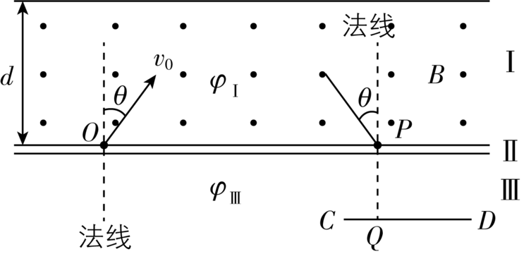

# Physics - 题目 1974

**ID**: 52056ba9e1d44bfe8c97f3ccf0402646
**年级**: Grade 12
**难度**: Medium-Hard
**题型**: 非选择题:本题共5小题,共55分。

## 题目
(11分)类似光学中的反射和折射现象,用磁场或电场调控也能实现质子束的“反射”和“折射”。​​​​​​​‌如图所示,在竖直平面内有三个平行区域Ⅰ、Ⅱ和Ⅲ;Ⅰ区宽度为d,存在磁感应强度大小为B、方向垂直平面向外的匀强磁场,Ⅱ区的宽度很小。Ⅰ区和Ⅲ区内电势处处相等,分别为φ_{Ⅰ}和φ_{Ⅲ},其电势差U=φ_{Ⅰ}-φ_{Ⅲ}。一束质量为m、电荷量为e的质子从O点以入射角θ射向Ⅰ区,在P点以出射角θ射出,实现“反射”;质子束从P点以入射角θ射入Ⅱ区,经Ⅱ区“折射”进入Ⅲ区,其出射方向与法线夹角为“折射”角。已知质子仅在平面内运动,单位时间发射的质子数为N,初速度为v_{0},不计质子重力,不考虑质子间相互作用以及质子对磁场和电势分布的影响。(1)若不同角度射向磁场的质子都能实现“反射”,求d的最小值;(2)若U=,求“折射率”n(入射角正弦与折射角正弦的比值);(3)计算说明如何调控电场,实现质子束从P点进入Ⅱ区发生“全反射”(即质子束全部返回Ⅰ区);(4)在P点下方距离处水平放置一长为的探测板CQD(Q在P的正下方),CQ长为,质子打在探测板上即被吸收中和。若还有另一相同质子束,与原质子束关于法线左右对称,同时从O点射入Ⅰ区,且θ=30°,求探测板受到竖直方向力F的大小与U之间的关系。

## 解答

1. (1)若水平向左射向磁场的质子能实现“反射”,则不同角度射向磁场的质子都能实现“反射”,有d_{min}=2r,
2. 由牛顿第二定律得
3. Bev_{0}=m(1分)
4. 解得d_{min}=(1分)
5. (2)质子在Ⅱ区内水平方向速度不变,在竖直方向速度变大,设折射角为θ',
6. 根据动能定理得
7. eU=m-m(1分)
8. 解得v_{1}=v_{0},v_{0}sin θ=v_{1}sin θ'
9. 则n===(1分)
10. (3)“全反射”临界状态:质子到达Ⅲ区的时候竖直方向速度为0,
11. 根据动能定理得
12. eU=-m(v_{0}cos θ)^{2}(1分)
13. 故U≤-时满足题设    	(1分)
14. (4)临界情况有两个:①全部都能打到探测板,②全部都打不到探测板。
15. ①∠CPQ=30°,如果U≥0,折射角比入射角小,两边射入的质子都能打到探测板上,
16. U≥0时,取竖直向上为正方向,根据动量定理得
17. F=2Nmv_{y}(1分)
18. 根据动能定理得
19. eU=m-m(v_{0}cos θ)^{2}(1分)
20. 解得F=2Nm→,
21. ②全部都打不到探测板的情况,
22. 临界情况为出射角为60°打到D点,
23. 水平方向速度v_{x}=v_{0},
24. 竖直方向速度v_{y}==v_{0},
25. 根据动能定理得
26. eU=m-m(1分)
27. 解得U=-,即当U<-时,F=0    	(1分)
28. ③当-≤U<0时,
29. 仅有一束质子能够打到探测板,则
30. F=Nmv_{y},
31. eU=m-m(v_{0}cos θ)^{2},
32. 解得F=Nm→(1分)

## 知识点

**中文**:
  - 带电粒子在有界磁场中运动的临界极值问题
  - 带电粒子在组合场中的运动

**English**:
  - Critical Extremum Problems in Bounded Magnetic Fields
  - Motion in Combined Fields

---
