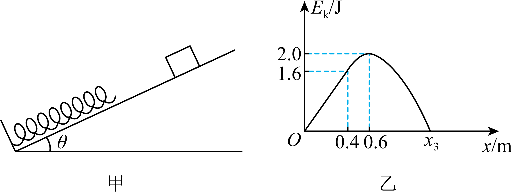

# Physics - 题目 2821

**ID**: 56045d13b87e41b5a55658efab47f18a
**年级**: Grade 12
**难度**: Medium-Hard
**题型**: Multiple-choice

## 题目
如图甲所示，轻弹簧下端固定在倾角为 $θ=37{}^\circ $ 的粗糙斜面底端，质量为 $m=1{\rm{k}}{\rm{g}}$ 的物块从轻弹簧上端上方某位置由静止释放，测得物块的动能 $E{{}_{{\rm{k}}}}$ 与其通过的路程x的关系如图乙所示（弹簧始终处于弹性限度内），图像中 $O\sim x{{}_{1}}=0.4{\rm{m}}$ 之间为直线，其余部分为曲线， $x{{}_{2}}=0.6{\rm{m}}$ 时物块的动能达到最大．弹簧的长度为l时，弹性势能为 $E{{}_{{\rm{p}}}}=\frac {1}{2}k{\left({l{{}_{0}}-l}\right)^{2}}$ ，其中k为弹簧的劲度系数， $l{{}_{0}}$ 为弹簧的原长。​​​​​​​‌物块可视为质点，不计空气阻力，物块接触弹簧瞬间无能量损失，取重力加速度 $g=10{\rm{m}}/{\rm{s}}{^{2}}$ ， ${\sin}37{}^\circ =0.6$ ， ${\cos}37{}^\circ =0.8$ 。则（      ）

## 解答

1. A．物块接触弹簧前，由动能定理得
2. $mgx{{}_{1}}{\sin}θ-{\rm μm}gx{{}_{1}}{\cos}θ=E{{}_{{\rm{k}}{{}_{1}}}}$
3. 解得
4. $μ=0.25$
5. 故A错误；
6. B．由能量守恒定律得
7. $mgx{{}_{2}}{\sin}θ={\rm μm}gx{{}_{2}}{\cos}θ+E{{}_{{\rm{k}}{{}_{2}}}}+\frac {1}{2}k{\left({x{{}_{2}}-x{{}_{1}}}\right)^{2}}$
8. 解得
9. $k=20{\rm{N}}{\rm{/}}{\rm{m}}$
10. 故B错误；
11. C．由能量守恒定律得
12. $mgx{{}_{3}}{\sin}θ={\rm μm}gx{{}_{3}}{\cos}θ+\frac {1}{2}k{\left({x{{}_{3}}-x{{}_{1}}}\right)^{2}}$
13. 解得
14. $x{{}_{3}}=(0.6+0.2\sqrt {5}){\rm{m}}$
15. 故C错误；
16. D．物块的路程为 $x{{}_{3}}$ 时
17. $mg{\sin}θ+{\rm μm}g{\cos}θ<k\left ({x{{}_{3}}-x{{}_{1}}}\right )$
18. 物块反向沿斜面向上运动，所以物块在斜面上运动的路程大于 $x{{}_{3}}$ ，故D正确。
19. 故选D。

## 知识点

**中文**:
  - 功能原理、能量守恒与曲线运动的综合

**English**:
  - Energy Conservation in Curvilinear Motion

---
