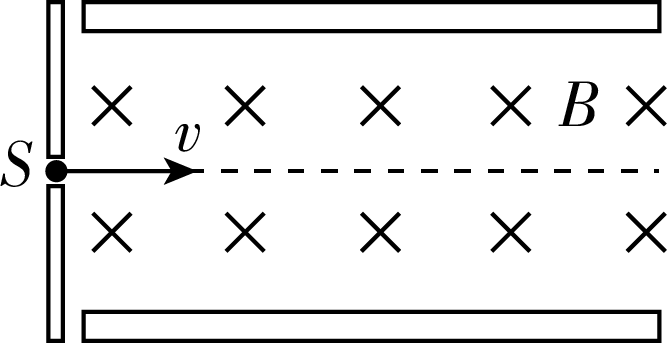

# Physics - 题目 1555

**ID**: 59de2f632204473d86fb0896e729ac46
**年级**: Grade 12
**难度**: Medium-Hard
**题型**: Multiple-choice

## 题目
如图所示,速度选择器的两平行导体板之间有方向互相垂直的匀强电场和匀强磁场,磁场方向垂直纸面向里。​​​​​​​‌一电荷量为+q的粒子以速度v从S点进入速度选择器后,恰能沿图中虚线通过。不计粒子重力,下列说法可能正确的是    	（      ）

## 解答

1. 电荷量为+q的粒子以速度v进入后受力平衡,即有qvB=qE,由左手定则可知,洛伦兹力竖直向上,由平衡条件可知,电场力竖直向下,即电场强度的方向竖直向下,且有E=vB。当电荷量为-q的粒子以速度v从S点进入后,由左手定则可知,粒子所受的洛伦兹力竖直向下,电场力竖直向上,且有qE=qvB,则粒子受力平衡,将沿着图中虚线通过,A错误;电荷量为+2q的粒子以速度v从S点进入后,向下的电场力大小F_{1}=2qE,向上的洛伦兹力大小F_{2}=2qvB,由于E=vB,所以粒子受力平衡,将沿着图中虚线通过,B错误;电荷量为+q的粒子以大于v的速度从S点进入后,向下的电场力大小F_{3}=qE,向上的洛伦兹力大小F_{4}>qvB,由于E=vB,所以F_{4}>F_{3},即粒子刚从S点进入时所受合力竖直向上,粒子的运动轨迹将向上弯曲,此过程中电场力对粒子做负功,粒子的动能将逐渐减小,C错误;电荷量为-q的粒子以大于v的速度从S点进入后,向上的电场力大小F_{5}=qE,向下的洛伦兹力大小F_{6}>qvB,由于E=vB,所以F_{6}>F_{5},即粒子刚从S点进入时所受合力竖直向下,粒子的运动轨迹将向下弯曲,此过程中电场力对粒子做负功,粒子的动能将逐渐减小,D正确。

## 知识点

**中文**:
  - 速度选择器

**English**:
  - Velocity Selector

---
