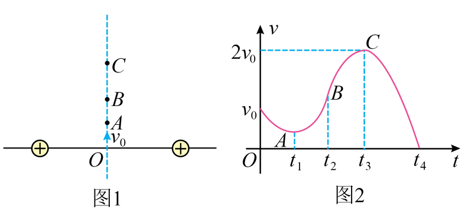

# Physics - 题目 95

**ID**: 5a4290b302344fd5b2cacddf554c084a
**年级**: Grade 12
**难度**: Medium-Hard
**题型**: Multiple-choice

## 题目
如图1所示，绝缘粗糙水平面上固定两个等量的正电荷，二者连线中点 $O$ 处有一质量为 $m$ 、电荷量为 $+q$ 的带电小物块（可视为质点），以初速度 $v{{}_{0}}=\sqrt {gL}$ 沿中垂线方向水平射出，途径A、B、C三点，小物块在A点速度最小，C点速度最大。​​​​​​​‌图2为小物块速度随时间变化的图像，整个图像在B点的切线斜率绝对值最大。已知小物块与水平面间的动摩擦因数为 $μ=0.5$ ，取C点电势为零，重力加速度为 $g$ ，OC距离为 $L$ ，下列说法正确的是（      ）

## 解答

1. 由题意可知，整个图像在B点的切线斜率绝对值最大，而斜率即表示加速度，小物块在B点时的加速度最大，A错误；小物块由O运动到C，由动能定理得 $qU{{}_{OC}}-F{{}_{{\rm{f}}}}L=\frac {1}{2}m{\left({2v{{}_{0}}}\right)^{2}}-\frac {1}{2}mv{{}_{0}^{2}}$ ，而 $F{{}_{{\rm{f}}}}={\rm μm}g$ ， $U{{}_{OC}}=φ{{}_{O}}-φ{{}_{C}}=φ{{}_{O}}$ ，联立解得 $O$ 点电势为 $φ{{}_{O}}=\frac {2mgL}{q}{\rm ，B}$ 错误； $0\sim t{{}_{1}}$ 时间内，小物块由O运动到A，电场力一直增大并作正功，电势能一直减小，C错误；由图2可知，A、C两点的加速度为0，小物块所受合力为0，得 $qE-F{{}_{{\rm{f}}}}=0$ ，而 $F{{}_{{\rm{f}}}}={\rm μm}g$ ，联立并代入数据得A、C两点的电场强度大小均为 $E=\frac {mg}{2q}{\rm ，D}$ 正确。

## 知识点

**中文**:
  - 静电场中的图像问题

**English**:
  - Graph Problems in Electrostatic Fields

---
