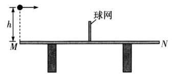

# Physics - 题目 2892

**ID**: 60463e5814b34a70b7e23694fe0634b0
**年级**: Grade 12
**难度**: Medium-Hard
**题型**: Multiple-choice

## 题目
乒乓球运动深受广大群众喜爱。​​​​​​​‌如图所示，球网固定在球台的中央，运动员在球台边缘中点M处正上方高为h处将乒乓球水平发出，乒乓球反弹后擦着掠过球网并落在对方球台边缘中点N处。已知乒乓球落到台面上反弹前后水平分速度不变，竖直分速度大小不变、方向相反，不考虑兵乓球的旋转和空气阻力，则球网的高度为（      ）

## 解答

1. 设球台长为2L，球网高度为H，兵乓球初速度为 ${v}_{0}$ ；
2. 乒乓球整个运动过程中两次达到最高点，对于第一次落到台面上，为第一次平抛运动，将从台面上反弹后又落回台面这一过程视为在最高点分别向左和右平抛的过程，所以乒乓球的运动过程拆分成了三次平抛运动，由于抛出的高度相同，所以从抛出到落回台面的时间都满足： $h=\frac{1}{2}g{t}_{0}^{2}$ ；
3. 在水平方向上每一次平抛运动都满足： ${v}_{0}{t}_{0}=x$ ；
4. 由于乒乓球反弹后速度大小不变，所以三次平抛运动的水平速度大小一样，所以水平位移相等，均为 $x=\frac{2L}{3}$ ，球网位于台面中间位置，所以第一次反弹到球网处的水平距离为 $\frac{L}{3}$ ；
5. 若将乒乓球反弹到最高点逆过程看作平抛运动，则从最高点到下落到高球网处的距离为 $\frac{2L}{3}-\frac{L}{3}=\frac{L}{3}$ ，令时间为t，则 ${v}_{0}t=\frac{L}{3}$ ， $h-H=\frac{1}{2}g{t}^{2}$ ，
6. 联立解得： $H-h=\frac{1}{2}g(\frac{L}{3{v}_{0}})^{2}$ ①
7. 又 $h=\frac{1}{2}g{t}_{0}^{2}$ ， ${v}_{0}{t}_{0}=\frac{2}{3}L$
8. 则 $h=\frac{1}{2}g(\frac{2L}{3{v}_{0}})^{2}$ ②
9. 解①②得 $H=\frac{3}{4}h$ ；
10. 故D正确，ABC错误。

## 知识点

**中文**:
  - 平抛运动中的临界问题

**English**:
  - Critical Problems in Horizontal Projectile Motion

---
