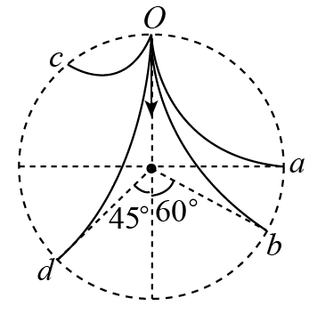

# Physics - 题目 1924

**ID**: 616a6476ce7d493d93c3a84c17ba1ed9
**年级**: Grade 12
**难度**: Medium-Hard
**题型**: Multiple-choice

## 题目
如图所示，圆形虚线框内有一垂直纸面向里的匀强磁场， $Oa$ 、 $Ob$ 、 $Oc$ 、 $Od$ 是以不同速率对准圆心入射的正电子或负电子的运动径迹，a、b、d三个出射点和圆心的连线分别与竖直方向成90°、60°、45°的夹角，则下列判断正确的是（      ）​​​​​​​‌

## 解答

1. A．由于正电子和负电子的电量q和质量m均相等，粒子在磁场中做匀速圆周运动，则有
2. $qvB=m\frac {v{^{2}}}{R}$
3. $T=\frac {2πR}{v}$
4. 解得
5. $T=\frac {2πm}{qB}$
6. 可知四种粒子的周期相等，而沿径迹 $Oc$ 运动的粒子偏转角最大，圆心角也最大，设偏转角为θ，由
7. $t=\frac {θ}{2π}T$
8. 可知沿径迹 $Oc$ 运动的粒子在磁场中运动时间最长，A项错误：
9. B．由左手定则可判断沿径迹 $Oc$ ， $Od$ 运动的粒子均带负电，B项错误；
10. C．设圆形磁场半径为r，根据几何关系可得沿径迹 $Oa$ ， $Ob$ 运动的粒子轨道半径分别为 $r{{}_{a}}=r$ ， $r{{}_{b}}=\sqrt {3}$ ，根据
11. $qBv=m\frac {v{^{2}}}{r}$
12. 可得
13. $\frac {v{{}_{a}}}{v{{}_{b}}}$  $=\frac {r{{}_{a}}}{r{{}_{b}}}=\frac {\sqrt {3}}{3}$
14. C项正确：
15. D．由前述分析可知，运动时间之比为偏转角之比所以
16. $\frac {t{{}_{b}}}{t{{}_{d}}}=\frac {θ{{}_{b}}}{θ{{}_{d}}}=\frac {60{}^\circ }{45{}^\circ }=\frac {4}{3}$
17. D项错误。
18. 故选C。

## 知识点

**中文**:
  - 带电粒子在有界匀强磁场中的运动

**English**:
  - Motion in Bounded Uniform Magnetic Field

---
