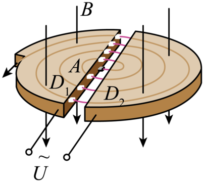

# Physics - 题目 2027

**ID**: 6442097cd508428fb3adbebad71c8024
**年级**: Grade 12
**难度**: Medium-Hard
**题型**: Multiple-choice

## 题目
如图所示，用同一个回旋加速器分别加速静止的氕核 $_{{\rm{1}}}^{{\rm{1}}}{\rm{H}}$ 、氘核 $_{{\rm{1}}}^{{\rm{2}}}{\rm{H}}$ 与氦核 $_{2}^{4}{\rm{H}}{\rm{e}}$ ，加速电压大小相等，磁场的磁感应强度大小相等，不考虑粒子在电场中的运动时间以及粒子质量的变化．则下列说法正确的是（      ）​​​​​​​‌

## 解答

1. A．加速电压周期等于粒子在磁场中的运动周期，则有
2. $T_{电}=T=\frac {2πm}{qB}$
3. 由于氘核 $_{{\rm{1}}}^{{\rm{2}}}{\rm{H}}$ 和氦核 $_{2}^{4}{\rm{H}}{\rm{e}}$ 的比荷 $\frac {q}{m}$ 相等，可知加速氘核 $_{{\rm{1}}}^{{\rm{2}}}{\rm{H}}$ 后再对氦核 $_{2}^{4}{\rm{H}}{\rm{e}}$ 进行加速，不需要重新调整加速电压周期，故A错误；
4. BC．当粒子在磁场中的轨道半径等于D型盒半径时，粒子的速度最大，动能最大，则有
5. $qvB=m\frac {v_{{\rm{m}}}^{{\rm{2}}}}{R}$
6. 解得最大速度为
7. $v_{{\rm{m}}}=\frac {qBR}{m}\propto \frac {q}{m}$
8. 由于氕核 $_{{\rm{1}}}^{{\rm{1}}}{\rm{H}}$ 的比荷 $\frac {q}{m}$ 在三种粒子中最大，则离开加速器时的速度最大的是氕核 $_{{\rm{1}}}^{{\rm{1}}}{\rm{H}}$ ；粒子的最大动能为
9. $E_{{\rm{k}}{\rm{m}}}=\frac {1}{2}mv_{{\rm{m}}}^{2}=\frac {q^{2}B^{2}R^{2}}{2m}\propto \frac {q^{2}}{m}$
10. 由于三种粒子中，氘核 $_{{\rm{1}}}^{{\rm{2}}}{\rm{H}}$ 的 $\frac {q^{2}}{m}$ 最小，则离开加速器时的动能最小的是氘核 $_{{\rm{1}}}^{{\rm{2}}}{\rm{H}}$ ，故BC错误；
11. D．粒子在电场加速的次数为
12. $n=\frac {E_{{\rm{k}}{\rm{m}}}}{qU}=\frac {qB^{2}R^{2}}{2mU}$
13. 粒子在回旋加速器中运动时间为
14. $t=n\cdot \frac {T}{2}=\frac {qB^{2}R^{2}}{2mU}\cdot \frac {πm}{qB}=\frac {πBR^{2}}{2U}$
15. 可知粒子在回旋加速器中运动时间与粒子的电荷量和质量均无关，则三种原子核在回旋加速器中运动时间相同，故D正确。
16. 故选D。

## 知识点

**中文**:
  - 回旋加速器

**English**:
  - Cyclotron

---
